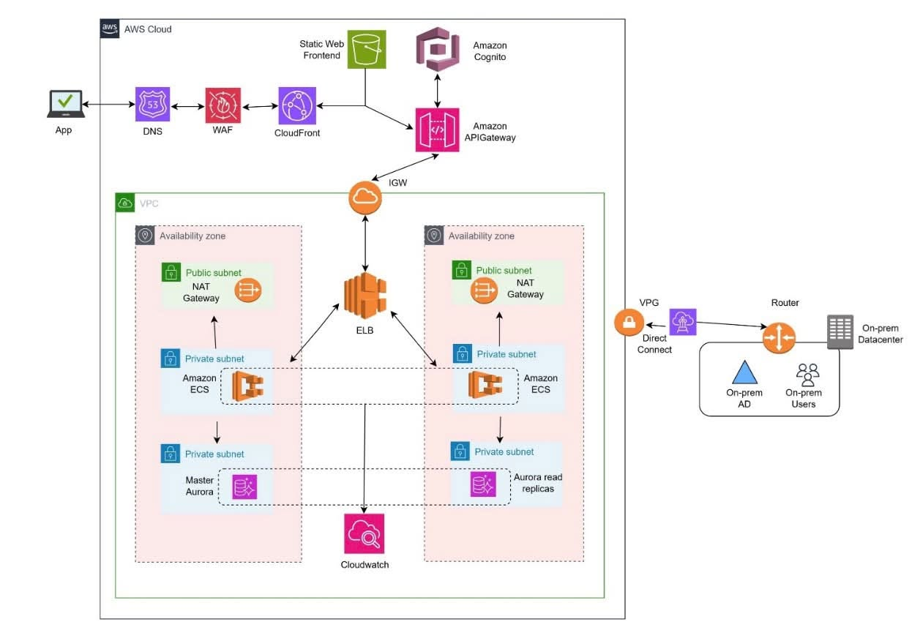

### CHUYỂN ĐỔI HỆ THỐNG MICROSOFT LÊN AWS: GIẢM 30% CHI PHÍ LICENSE VÀ 60% PHÍ LƯU TRỮ

**Đăng tại:** AWS Study Group (Facebook)

Đưa hệ thống .NET Framework và SQL Server cũ lên Cloud theo mô hình Lift-and-Shift chưa đủ để giải quyết bài toán chi phí bản quyền và khả năng mở rộng. Một ví dụ thực tế từ TEKsystems Global Services (TGS) cho thấy cách hiện đại hóa toàn bộ nền tảng Microsoft của một trường đại học sang kiến trúc Cloud-Native trên AWS.

*Nguồn: AWS Blog (xem tài liệu tham khảo bên dưới).*

**Các điểm chính cần nắm:**

- **Phân tích hệ thống:** ứng dụng Monolith có 785.000 dòng code, 342 bảng dữ liệu và 63 Stored Procedures. Đội ngũ dùng CAST Highlight (rủi ro mã nguồn và rào cản chuyển lên Cloud), CAST Imaging (trực quan hóa luồng dữ liệu và phụ thuộc, giảm 80% thời gian phân tích) và Babelfish Compass (đánh giá khả năng chuyển từ SQL Server sang PostgreSQL).
- **Kết quả phân tích:** chỉ khoảng 20.000 dòng code nằm ở tầng Database, nên việc thay thế SQL Server thuận lợi.
- **Monolith sang Microservices:** dùng AWS Microservices Extractor for .NET để phân tích và tách ứng dụng thành các dịch vụ độc lập.
- **.NET Framework sang .NET 8:** kết hợp Porting Assistant và AWS Transform for .NET, chạy trên Linux và AWS Graviton (Arm64).
- **Database và Storage:** chuyển SQL Server sang PostgreSQL và Amazon FSx sang Amazon S3.
- **Kiến trúc mới theo Well-Architected:** Amazon ECS chạy Linux Container, Amazon ELB và Route 53, Amazon S3 và CloudFront, AWS WAF và Amazon Cognito, Amazon API Gateway, Amazon CloudWatch, và AWS Organizations để quản lý tập trung và Audit Log.
- **Hai kết quả chi phí:** tiết kiệm 30% chi phí bản quyền thương mại và 60% chi phí lưu trữ.

**Kết luận và cảm nghĩ:**

Cloud Modernization không đơn thuần là di chuyển máy chủ lên Cloud. Việc tái cấu trúc ứng dụng, lựa chọn nền tảng phù hợp và tối ưu kiến trúc mới là chìa khóa giúp giảm chi phí, tăng khả năng mở rộng và cải thiện hiệu quả vận hành.

**Tài liệu tham khảo:**

1. AWS Blog: How TEKsystems modernized a university's Microsoft workloads on AWS — [aws.amazon.com/blogs/modernizing-with-aws](https://aws.amazon.com/blogs/modernizing-with-aws/how-teksystems-modernized-a-universitys-microsoft-workloads-on-aws)
2. AWS Transform for .NET (AWS Documentation, User Guide).
3. AWS Microservices Extractor for .NET (AWS Documentation).
4. Modernize Windows Workloads — [aws.amazon.com/vi/transform/windows](https://aws.amazon.com/vi/transform/windows/)

**Link:** [Bài viết trên AWS Study Group](https://www.facebook.com/groups/660548818043427/?multi_permalinks=2340011250097167)
