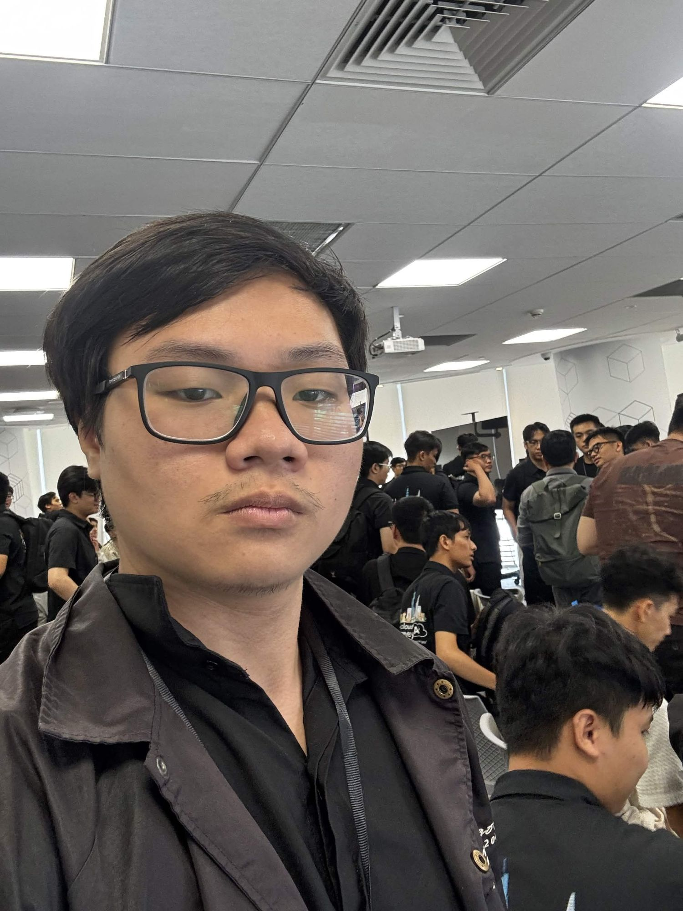
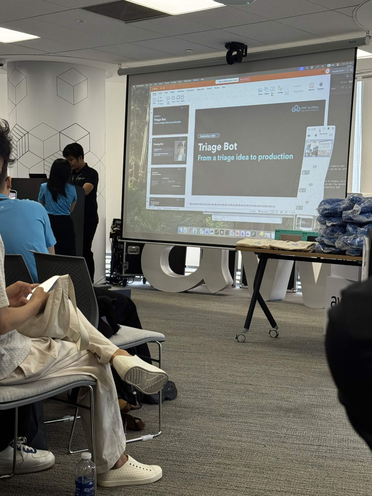
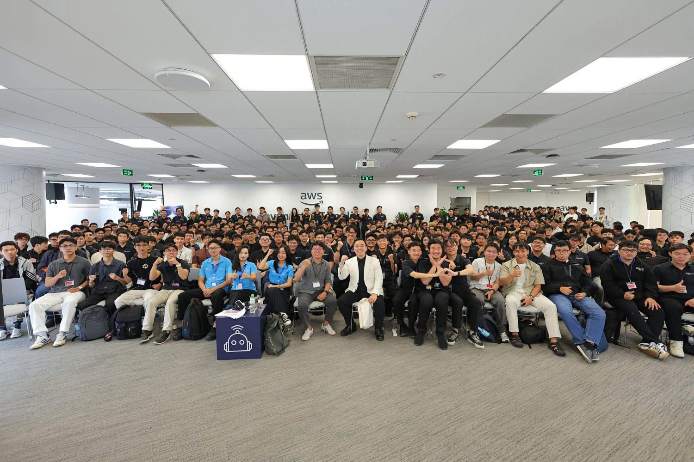
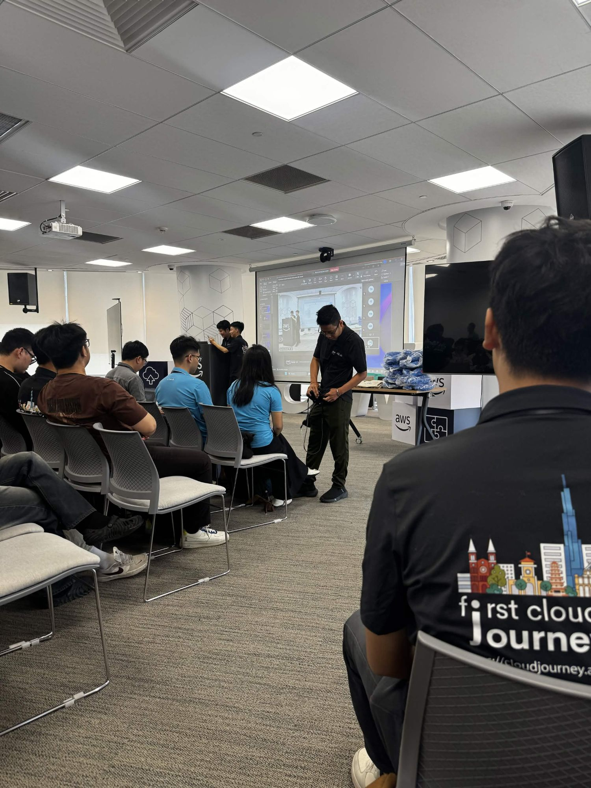

### Tổng Hợp Thu Hoạch

| | |
|---|---|
| **Thời gian** | 09:00 – 12:00, ngày 26/09/2026 |
| **Đơn vị tổ chức** | Amazon Web Services Viet Nam Company Limited |
| **Địa điểm** | Tầng 26, tòa nhà Bitexco, số 02 đường Hải Triều, phường Sài Gòn, thành phố Hồ Chí Minh |
| **Vai trò** | Người tham dự |

---

### 1. Mục Đích Của Sự Kiện

Buổi Kickoff FCAJ Buildrathon 2026 – Season 01 mở màn cho mùa giải mới, bắt đầu hành trình 6 tháng học hỏi, thực hành và giải các bài toán về AI và Cloud.

Ngoài phần giới thiệu cuộc thi, chương trình có talkshow **"The Thinking Behind Building The Bot"** do CMC Global phối hợp cùng VietAWS tổ chức. Talkshow chia sẻ kinh nghiệm thực tế khi xây dựng và triển khai AI Agent trong doanh nghiệp.

Người tham dự cũng được trao đổi trực tiếp với các chuyên gia, cùng phân tích một số bài toán kỹ thuật, và có buổi tư vấn, phỏng vấn 1-1 với Phòng Tuyển dụng CMC Global để tìm hiểu về định hướng nghề nghiệp.

---

### 2. Danh Sách Diễn Giả

- **Thien Lu** – Program Manager, FCAJ
- **Truong Bui** – Tech Lead, CMC Global
- **Phong Pham** – Program Manager, FCAJ
- **Đại diện Phòng Tuyển dụng CMC Global** – Tư vấn, trao đổi và định hướng nghề nghiệp cho người tham gia

---

### 3. Nội Dung Nổi Bật

**Cách Nghĩ Về AI Agent Trong Doanh Nghiệp**

Một phần đáng chú ý là cách xây dựng AI Agent và đưa nó vào giải quyết những việc thật trong doanh nghiệp.

- **Nghĩ về kiến trúc trước:** Trước khi viết code, cần xác định rõ cấu trúc hệ thống và luồng dữ liệu, để việc phát triển sau đó dễ hơn.
- **Nhìn từ góc độ doanh nghiệp:** Một AI Agent chạy được thôi là chưa đủ. Còn phải tính đến hiệu năng, bảo mật và chi phí vận hành.

**Phân Tích Bài Test Cùng Chuyên Gia**

Phần phân tích các bài test thực tế cho thấy cách xử lý những vấn đề kỹ thuật hay gặp.

- **Phân tích bài test:** Cách bóc tách yêu cầu, những lỗi dễ mắc và cách chọn hướng giải phù hợp.
- **Kinh nghiệm thực tế:** Các chuyên gia kể về những khó khăn khi triển khai dự án.

**Kết Nối Nghề Nghiệp Và Tinh Thần Cộng Đồng**

- **Trao đổi 1-1 với HR của CMC Global:** Tìm hiểu yêu cầu công việc và nhận góp ý về năng lực của mình.
- **Tinh thần Pay It Forward:** VietAWS và CMC Global tạo ra một môi trường chia sẻ kiến thức, kinh nghiệm và kết nối những người cùng đam mê công nghệ.

---

### 4. Những Gì Học Được

**Tư Duy Thiết Kế**

- **Kiến trúc trước, tính năng sau:** Mình hiểu rõ hơn vì sao cần xác định kiến trúc và luồng xử lý tổng thể trước khi làm từng tính năng của Bot.
- **Giải quyết vấn đề thật:** Một sản phẩm AI không cần dùng công nghệ mới nhất. Quan trọng là nó giải được một vấn đề cụ thể và đáp ứng nhu cầu của người dùng.

**Kiến Trúc Kỹ Thuật**

- **Chia nhỏ bài toán:** Với yêu cầu phức tạp, nên chia thành các phần nhỏ để dễ làm, dễ kiểm tra và dễ chỉnh sửa.
- **Chú ý đến độ ổn định:** Cần xử lý lỗi, các trường hợp ngoại lệ và tối ưu thời gian phản hồi để Bot chạy tốt hơn.

**Phát Triển Bản Thân**

- **Tiêu chuẩn tuyển dụng:** Qua chia sẻ của HR CMC Global, mình biết rõ hơn những kỹ năng và kiến thức cần có khi ứng tuyển vào vị trí công nghệ.
- **Hồ sơ từ dự án thật:** Tham gia dự án và thử thách thực tế là cách tốt để tích lũy kinh nghiệm, đồng thời có sản phẩm cụ thể để đưa vào hồ sơ năng lực.

---

### 5. Ứng Dụng Vào Công Việc

- **Làm Bot theo thứ tự mới:** Mình sẽ thiết kế kiến trúc và xác định luồng xử lý trước, rồi mới làm từng chức năng, thay vì bắt đầu từ các chức năng rời rạc.
- **Chuẩn bị cho FCAJ Buildrathon 2026:** Mình sẽ chia nhỏ bài toán để chuẩn bị tốt hơn cho các thử thách, và phối hợp với thành viên trong nhóm dễ hơn.
- **Tăng năng suất cá nhân:** Mình sẽ tìm hiểu và thử các công cụ AI Agent có thể tự động hóa những việc lặp lại hằng ngày để tiết kiệm thời gian.

---

### 6. Trải Nghiệm Trong Event

Mình tham dự buổi Kickoff FCAJ Buildrathon 2026 (Season 01) và talkshow của CMC Global cùng VietAWS. Không khí khá sôi nổi, có nhiều người quan tâm đến AI và Cloud.

**Học Từ Các Diễn Giả**

Anh Truong Bui (Tech Lead, CMC Global), anh Thien Lu và anh Phong Pham (Program Manager, FCAJ) chia sẻ từ nhiều góc nhìn, từ kỹ thuật đến cách tổ chức và triển khai dự án thực tế. Nội dung dễ hiểu và nói về những vấn đề mình có thể gặp khi đi làm.

**Phần Kỹ Thuật Thực Tế**

Phần phân tích bài test để lại cho mình ấn tượng nhất. Nhìn các chuyên gia tách vấn đề và chọn hướng giải, mình thấy chỉ có kiến thức kỹ thuật là chưa đủ. Cách tiếp cận và tư duy xử lý cũng quan trọng không kém.

**Kết Nối Và Trao Đổi**

Buổi tư vấn 1-1 với Phòng Tuyển dụng CMC Global rất có giá trị. Mình biết thêm về môi trường làm việc thực tế và những kỹ năng doanh nghiệp đang tìm. Tinh thần chia sẻ và giúp đỡ nhau của cộng đồng VietAWS và CMC Global cũng là điều mình thấy ý nghĩa nhất.

---

### 7. Bài Học Rút Ra

- **Kiến trúc là nền tảng:** Trước khi làm sản phẩm, nên nhìn tổng thể cấu trúc hệ thống và cách các thành phần phối hợp. Kiến trúc hợp lý giúp việc phát triển, bảo trì và mở rộng về sau dễ hơn.
- **Thực hành giúp hiểu sâu:** Kiến thức lý thuyết chỉ thật sự có ý nghĩa khi áp dụng vào bài toán cụ thể. Phải tự làm mới thấy được khó khăn và chỗ mình còn thiếu.
- **Chủ động kết nối:** Trao đổi với chuyên gia, đồng nghiệp và nhà tuyển dụng giúp mình mở rộng góc nhìn và có thêm định hướng cho nghề nghiệp.

---

### 8. Một Số Hình Ảnh Khi Tham Gia Sự Kiện

