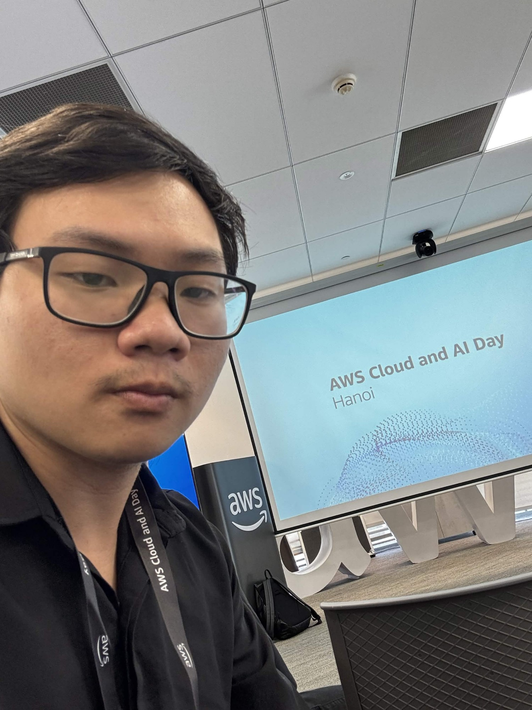
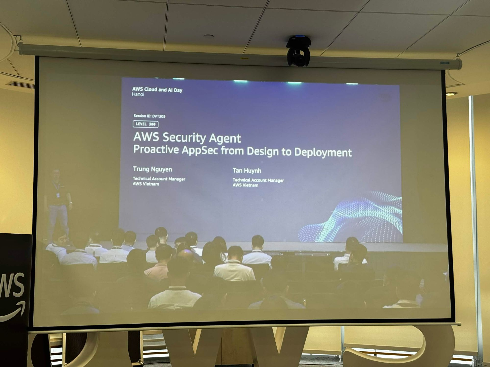
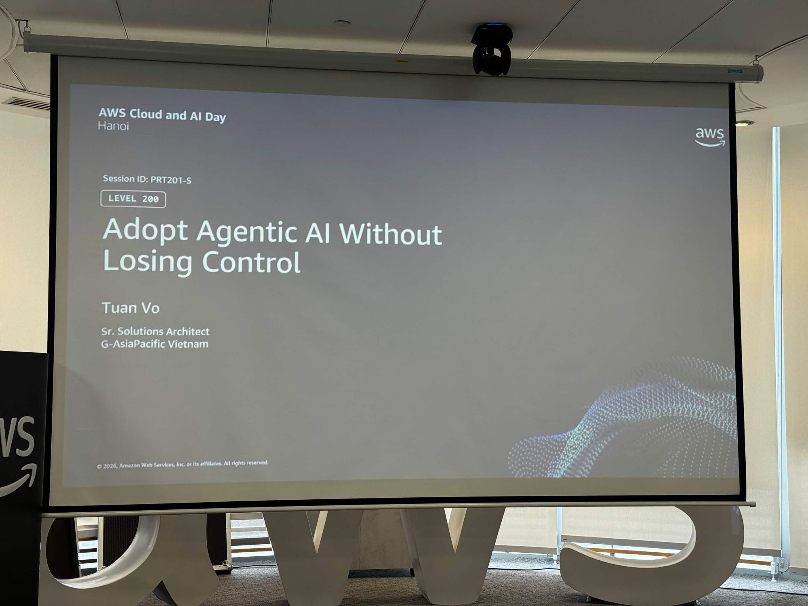
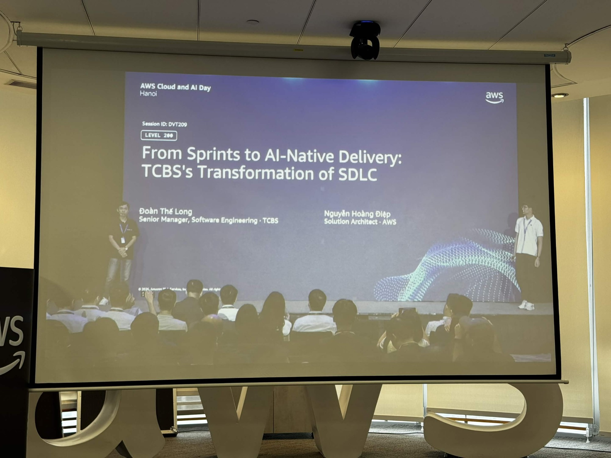

### AWS Cloud and AI Day

| | |
|---|---|
| **Date & Time** | 08:30 – 17:00, October 2, 2026 |
| **Organizer** | Amazon Web Services Viet Nam Company Limited |
| **Location** | 26th Floor, Bitexco Tower, No. 02 Hai Trieu Street, Saigon Ward, Ho Chi Minh City |
| **Role** | Attendee |

---

### 1. Purpose of the Event

AWS Cloud and AI Day brought together the latest perspectives on Cloud Computing and AI trends, showcasing technology solutions being applied in Vietnam and globally.

Through keynote sessions, talkshows, and expert deep-dives, the program covered digital infrastructure, Generative AI, Agentic AI, security, automated testing, AI governance, and AI-driven software development methodologies.

---

### 2. Speakers

- **Dr. Werner Vogels** – CTO, Amazon.com
- **Dr. Jens Lottner** – CEO, Techcombank
- **Mai Le** – Director of Product Management, Katalon
- **Võ Xuân Minh Tuấn** – Senior Solution Architect, AWS
- **Representatives from Vietnam's Ministry of Science and Technology**
- **AWS and technology partner representatives**

---

### 3. Key Highlights

**Vietnam's Digital Infrastructure and AI Strategy**

- Vietnam has 42 commercial data centers with ~372 MW total design capacity. 4G coverage is at 99.8% and 5G at ~91.9% of the population.
- Four strategic pillars: digital infrastructure, data and AI, technology workforce development, and a comprehensive tech ecosystem.
- AWS completed regulatory requirements to provide cloud services in Vietnam since February 2025 and launched AWS Local Zones.

**Cloud and AI in Vietnamese Enterprises**

- **AMI Group:** PoC on Amazon Bedrock and EC2 to trace molecular origins of chronic diseases.
- **Vinasoy:** Generative AI on SageMaker and Bedrock — increased retail display monitoring by 70%+, reduced stockouts by 20%, cut scoring time from 20+ days to under 2 days.
- **Agris:** Centralized data platform on Amazon Redshift and AWS Glue — reduced audit and reconciliation time by 50%.
- **Banking sector:** BIDV, VPBank, and ACBS using Cloud and AI for process automation and investment assistant tools.

**Agentic AI Strategy at Techcombank (Dr. Jens Lottner)**

- AI amplifies human capability rather than replacing people.
- Target: 90% of staff proficient in Agentic tools.
- AI Coach deployed to help employees choose the right model, optimize cost, and improve prompt quality.
- Governance requires clear ROI, safety guardrails, and monitoring mechanisms.

**Invisible Engineering – Dr. Werner Vogels**

- **Dynamo and NoSQL:** Foundational work for distributed storage systems.
- **AWS Nitro:** Offloads network, storage, and security to dedicated hardware.
- **Serverless & Lambda:** Improved with Firecracker MicroVM and SnapStart.
- **Distributed Time:** Atomic clocks and proprietary network infrastructure for accuracy in large-scale distributed systems.

**Closing the Testing Gap in the GenAI Era (Mai Le – Katalon)**

- **Validation Gap:** AI generates code faster than testing can keep up.
- **Agentic Workflows:** AI Agents integrated across the software development lifecycle.
- **AI-led, Human-governed:** AI executes, humans set boundaries and own the final outcome.

**AI Security Agent and Automated Security Testing**

- AI supports design document review, threat analysis, code scanning, and security testing throughout the SDLC.
- Parallel execution reduces testing time compared to manual methods.

**AI-driven Development Lifecycle**

- Evolution: AI Assistant → AI Agents → Autonomous Agents.
- **AI-DLC:** Three phases — Inception, Construction, and Operation — unified into one workflow.
- **Spec-Driven Development:** Detailed specs guide AI to implement correctly.
- **Kiro and Agent Client Protocol:** IDE built for agent-assisted development.

**AI Governance with Amazon Q (Võ Xuân Minh Tuấn – AWS)**

- **Shadow AI** risk: employees using external AI tools create security and data governance gaps.
- **Amazon Q Business:** Connects to internal data sources.
- **Amazon QuickSight:** Generative BI with natural language queries.
- **Amazon Bedrock Agent Core Runtime:** Isolated execution environment for AI Agent tasks.

---

### 4. What I Learned

**Thinking About Cloud and AI**

- **The role of the cloud:** It lowers the burden of managing infrastructure and also gives a base for building systems that can scale.
- **AI must solve a specific problem:** The value of AI is the real result it delivers, not the model that is used.
- **Agentic AI:** AI agents can work together on a complex process, instead of answering one command at a time.

**Technical Knowledge**

- **System architecture:** Dynamo, Nitro, Lambda and Firecracker show that good architecture design is what delivers performance, security and scalability.
- **Spec-Driven Development:** Define the requirements and write a clear specification before working with AI.
- **Testing and security:** They must be built in across the whole development process, not only at the end.
- **AI governance:** It needs control over data, cost, access rights and the results that AI produces.

**Personal Development**

- Cloud and AI change fast, so keep learning and practicing.
- Technical knowledge creates value when it is applied to a specific problem.
- Stay in charge: AI helps with many tasks, but the user must evaluate, verify and take responsibility.

---

### 5. Application to Work

- **Use AI in software development:** Use AI agents to help analyze requirements, build the project structure, write code and create test cases.
- **Focus on Spec-Driven Development:** Describe the requirements and write a clear specification before implementing.
- **Strengthen testing:** Write unit tests, check edge cases and verify the results produced by AI.
- **Care about security:** Manage credentials and access rights, and protect data.
- **Learn more about AWS:** Amazon Bedrock, AWS Lambda, Amazon S3 and the tools for building AI agents.

---

### 6. Event Experience

Attending AWS Cloud and AI Day was a very useful learning experience. The program offered a lot of in-depth content about cloud, AI and technology trends in business.

The keynote by **Dr. Werner Vogels** on Invisible Engineering left a deep impression. The stories about Dynamo, Nitro and serverless show that behind a stable service there are many continuous technical improvements.

**Dr. Jens Lottner**'s talk on Agentic AI at Techcombank gave a practical view: AI does not replace people, it amplifies human capability.

The case studies of Vinasoy, Agris and AMI Group made it clearer how cloud and AI are used in different fields. Each business has its own problem, and the technology choice should start from real needs.

The message **"Now go build"** from Dr. Werner Vogels is a reminder not to stop at theory but to start practicing.

---

### 7. Key Takeaways

- **Technology must deliver real value:** Cloud and AI matter when they solve specific problems and produce measurable outcomes.
- **Quality and security cannot be skipped:** AI accelerates development speed, but testing, validation, and data protection remain mandatory.
- **Humans stay in control:** AI handles complex tasks, but people must set requirements, verify results, and own the final product.

---

### 8. Photos

