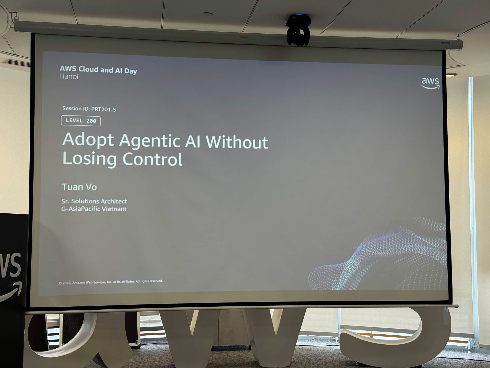

### AWS Cloud and AI Day

| | |
|---|---|
| **Thời gian** | 08:30 – 17:00, ngày 02/10/2026 |
| **Đơn vị tổ chức** | Amazon Web Services Viet Nam Company Limited |
| **Địa điểm** | Tầng 26, tòa nhà Bitexco, số 02 đường Hải Triều, phường Sài Gòn, thành phố Hồ Chí Minh |
| **Vai trò** | Người tham dự |

---

### 1. Mục Đích Của Sự Kiện

Sự kiện AWS Cloud and AI Day được tổ chức nhằm mang đến cho người tham gia những góc nhìn mới nhất về xu hướng phát triển của Cloud Computing và Artificial Intelligence (AI), đồng thời giới thiệu những giải pháp công nghệ đang được ứng dụng trong thực tế tại Việt Nam và trên thế giới.

Thông qua các phiên keynote, talkshow và chia sẻ chuyên sâu từ những chuyên gia trong ngành, chương trình giúp người tham gia hiểu rõ hơn về vai trò của hạ tầng số, điện toán đám mây, Generative AI và Agentic AI trong quá trình chuyển đổi số của doanh nghiệp.

Bên cạnh đó, sự kiện còn tập trung vào những vấn đề quan trọng như bảo mật thông tin, tự động hóa kiểm thử, quản trị AI trong doanh nghiệp và phương pháp phát triển phần mềm trong kỷ nguyên AI.

---

### 2. Danh Sách Diễn Giả

- **Dr. Werner Vogels** – CTO, Amazon.com
- **Dr. Jens Lottner** – CEO, Techcombank
- **Mai Le** – Director of Product Management, Katalon
- **Võ Xuân Minh Tuấn** – Senior Solution Architect, AWS
- **Đại diện Bộ Khoa học và Công nghệ Việt Nam** – Định hướng phát triển hạ tầng số, dữ liệu và AI tại Việt Nam
- **Các đại diện AWS và đối tác công nghệ** – Giải pháp Cloud, AI, bảo mật và ứng dụng thực tế

---

### 3. Nội Dung Nổi Bật

**Định Hướng Phát Triển Hạ Tầng Số Và AI Tại Việt Nam**

- **Hiện trạng hạ tầng số:** Việt Nam hiện có 42 trung tâm dữ liệu thương mại với tổng công suất thiết kế khoảng 372 MW. Độ phủ sóng 4G đạt 99,8% và 5G đạt khoảng 91,9% dân số.
- **Bốn trụ cột chiến lược:** Hạ tầng số, dữ liệu và AI, phát triển nguồn nhân lực công nghệ, và xây dựng hệ sinh thái công nghệ toàn diện.
- **Hợp tác cùng AWS:** AWS đã hoàn thành thủ tục cung cấp dịch vụ đám mây tại Việt Nam từ tháng 2/2025 và đưa AWS Local Zones vào vận hành.

**Ứng Dụng Cloud Và AI Trong Doanh Nghiệp Việt Nam**

- **AMI Group:** Phát triển PoC AMI Keiji trên Amazon Bedrock và EC2 nhằm truy vết nguồn gốc phân tử của các bệnh mãn tính.
- **Vinasoy:** Ứng dụng Generative AI trên Amazon SageMaker và Bedrock, tăng tỷ lệ giám sát trưng bày tại điểm bán lên hơn 70%, giảm 20% tỷ lệ đứt hàng và rút ngắn thời gian chấm điểm từ hơn 20 ngày xuống dưới 2 ngày.
- **Agris:** Xây dựng nền tảng dữ liệu tập trung trên Amazon Redshift và AWS Glue, giảm 50% thời gian kiểm toán và đối soát.
- **Lĩnh vực ngân hàng:** BIDV, VPBank và ACBS ứng dụng Cloud và AI vào tự động hóa quy trình nghiệp vụ và phát triển trợ lý ảo hỗ trợ đầu tư.

**Chiến Lược Agentic AI Tại Techcombank (Dr. Jens Lottner)**

- AI không sinh ra để thay thế con người mà nhằm khuếch đại năng lực của con người.
- **Phát triển nhân lực:** 90% nhân sự biết cách sử dụng các công cụ Agentic.
- **AI Coach:** Trợ lý AI hỗ trợ nhân viên lựa chọn mô hình phù hợp, tối ưu chi phí và cải thiện kỹ năng viết prompt.
- **Quản trị và kiểm soát:** Cần xác định rõ ROI, xây dựng các hàng rào an toàn và duy trì cơ chế giám sát.

**Invisible Engineering – Dr. Werner Vogels**

- **Dynamo và NoSQL:** Từ vấn đề mở rộng của CSDL truyền thống, AWS phát triển Dynamo, đặt nền móng cho cơ sở dữ liệu phân tán.
- **AWS Nitro:** Tách tác vụ mạng, lưu trữ và bảo mật sang phần cứng chuyên dụng, tăng cường bảo mật.
- **Serverless & Lambda:** Cải tiến qua Firecracker MicroVM và SnapStart, giảm thời gian khởi động.
- **Distributed Time:** Dùng đồng hồ nguyên tử và hạ tầng mạng riêng để cải thiện độ chính xác trong hệ thống phân tán.

**Thu Hẹp Khoảng Cách Kiểm Thử Trong Kỷ Nguyên GenAI (Mai Le – Katalon)**

- **Validation Gap:** AI tạo mã nhanh hơn, nhưng kiểm thử chưa theo kịp.
- **Fragmented Context:** Thông tin về yêu cầu, tài liệu và kết quả kiểm thử bị phân tán giữa nhiều hệ thống.
- **Agentic Workflows:** Tích hợp AI Agent xuyên suốt vòng đời phát triển phần mềm.
- **AI-led, Human-governed:** AI chủ động thực hiện tác vụ, con người kiểm soát giới hạn và chịu trách nhiệm cuối cùng.

**AI Security Agent Và Tự Động Hóa Kiểm Thử Bảo Mật**

- **Khoảng cách bảo mật:** Phần mềm phát hành nhanh nhưng kiểm thử bảo mật chậm hơn.
- **AI Security Agent:** Hỗ trợ đánh giá tài liệu thiết kế, phân tích nguy cơ, rà soát mã nguồn và kiểm thử bảo mật.
- **Tự động hóa song song:** Rút ngắn thời gian kiểm thử so với phương pháp thủ công.

**AI-driven Development Lifecycle Và Tương Lai Phần Mềm**

- **AI Assistant → AI Agents → Autonomous Agents:** Tiến hóa từ gợi ý code đến thực hiện tác vụ hoàn chỉnh.
- **AI-DLC:** Ba giai đoạn Inception, Construction và Operation kết nối thành quy trình thống nhất.
- **Spec-Driven Development:** Dùng bản đặc tả chi tiết để AI hiểu đúng yêu cầu.
- **Kiro và Agent Client Protocol:** Môi trường phát triển hỗ trợ Agent, kết nối và điều phối công cụ AI.

**Quản Trị AI Với Amazon Q (Võ Xuân Minh Tuấn – AWS)**

- **Shadow AI:** Nhân viên tự dùng công cụ AI bên ngoài gây rủi ro bảo mật và phân tán dữ liệu.
- **Amazon Q Business:** Kết nối với dữ liệu nội bộ, hỗ trợ nhân viên khai thác thông tin.
- **Amazon QuickSight:** Generative BI cho phép đặt câu hỏi bằng ngôn ngữ tự nhiên.
- **Amazon Bedrock Agent Core Runtime:** Môi trường thực thi cách ly, kiểm soát tác vụ AI Agent.

---

### 4. Những Gì Học Được

**Tư Duy Về Cloud Và AI**

- **Vai trò của Cloud:** Không chỉ giảm gánh nặng quản lý hạ tầng mà còn tạo nền tảng để phát triển hệ thống có khả năng mở rộng.
- **AI cần giải quyết bài toán cụ thể:** Giá trị của AI nằm ở hiệu quả thực tế mà nó mang lại, không phải ở mô hình được sử dụng.
- **Agentic AI:** AI Agent có thể phối hợp để thực hiện quy trình phức tạp, thay vì chỉ phản hồi từng lệnh riêng lẻ.

**Kiến Thức Kỹ Thuật**

- **Kiến trúc hệ thống:** Dynamo, Nitro, Lambda và Firecracker — tầm quan trọng của thiết kế kiến trúc để đảm bảo hiệu năng, bảo mật và khả năng mở rộng.
- **Spec-Driven Development:** Xác định yêu cầu và xây dựng đặc tả rõ ràng trước khi phối hợp với AI.
- **Kiểm thử và bảo mật:** Cần tích hợp xuyên suốt quá trình phát triển, không chỉ ở giai đoạn cuối.
- **Quản trị AI:** Cần cơ chế kiểm soát dữ liệu, chi phí, quyền truy cập và kết quả do AI tạo ra.

**Tư Duy Phát Triển Bản Thân**

- Công nghệ Cloud và AI thay đổi nhanh — cần chủ động học hỏi và thực hành liên tục.
- Kiến thức kỹ thuật cần được vận dụng vào bài toán cụ thể để tạo ra giá trị.
- Giữ vai trò chủ động: AI hỗ trợ nhiều công việc nhưng người dùng cần đánh giá, kiểm chứng và chịu trách nhiệm.

---

### 5. Ứng Dụng Vào Công Việc

- **Ứng dụng AI vào phát triển phần mềm:** Dùng AI Agent hỗ trợ phân tích yêu cầu, xây dựng cấu trúc dự án, viết mã và tạo test case.
- **Chú trọng Spec-Driven Development:** Mô tả yêu cầu và xây dựng đặc tả rõ ràng trước khi triển khai.
- **Tăng cường kiểm thử:** Viết unit test, kiểm tra trường hợp ngoại lệ và xác thực kết quả do AI tạo ra.
- **Quan tâm đến bảo mật:** Quản lý thông tin xác thực, quyền truy cập và bảo vệ dữ liệu.
- **Tìm hiểu thêm AWS:** Amazon Bedrock, AWS Lambda, Amazon S3 và các công cụ xây dựng AI Agent.

---

### 6. Trải Nghiệm Trong Event

Tham gia sự kiện AWS Cloud and AI Day là một trải nghiệm học hỏi rất hữu ích. Chương trình mang đến nhiều nội dung chuyên sâu về Cloud, AI và xu hướng công nghệ trong doanh nghiệp.

Phần keynote của **Dr. Werner Vogels** về Invisible Engineering để lại ấn tượng sâu sắc — những câu chuyện về Dynamo, Nitro và Serverless cho thấy phía sau một dịch vụ ổn định là rất nhiều cải tiến kỹ thuật liên tục.

Phần chia sẻ của **Dr. Jens Lottner** về Agentic AI tại Techcombank mang đến góc nhìn thực tế: AI không thay thế mà khuếch đại năng lực con người.

Các case study của Vinasoy, Agris và AMI Group giúp hình dung rõ hơn cách Cloud và AI được ứng dụng trong nhiều lĩnh vực — mỗi doanh nghiệp có bài toán riêng, lựa chọn công nghệ cần xuất phát từ nhu cầu thực tế.

Thông điệp **"Now go build"** của Dr. Werner Vogels là lời nhắc để không dừng lại ở lý thuyết mà cần bắt tay vào thực hành.

---

### 7. Bài Học Rút Ra

- **Công nghệ cần gắn liền với giá trị thực tế:** Cloud và AI chỉ có ý nghĩa khi giải quyết được vấn đề cụ thể và mang lại hiệu quả rõ ràng.
- **Chất lượng và bảo mật không thể bị xem nhẹ:** Tốc độ phát triển có thể cải thiện nhờ AI, nhưng kiểm thử và bảo vệ dữ liệu vẫn là yếu tố bắt buộc.
- **Con người giữ vai trò định hướng:** AI hỗ trợ nhiều tác vụ phức tạp, nhưng con người cần đặt yêu cầu, kiểm soát kết quả và chịu trách nhiệm sản phẩm cuối cùng.

---

### 8. Một Số Hình Ảnh Khi Tham Gia Sự Kiện

