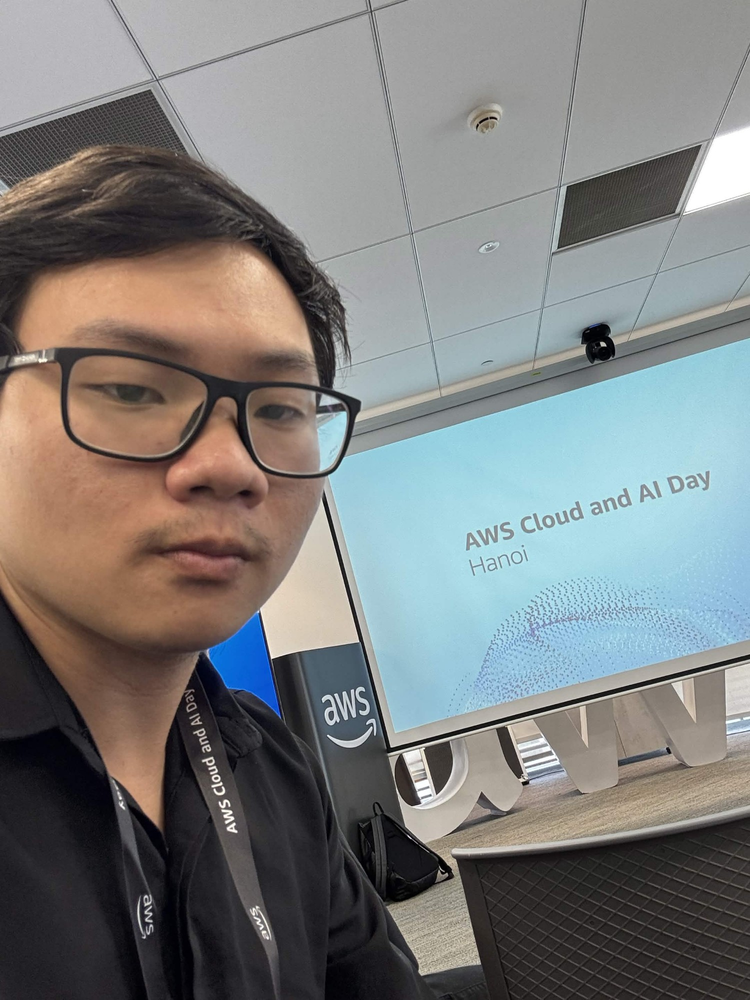
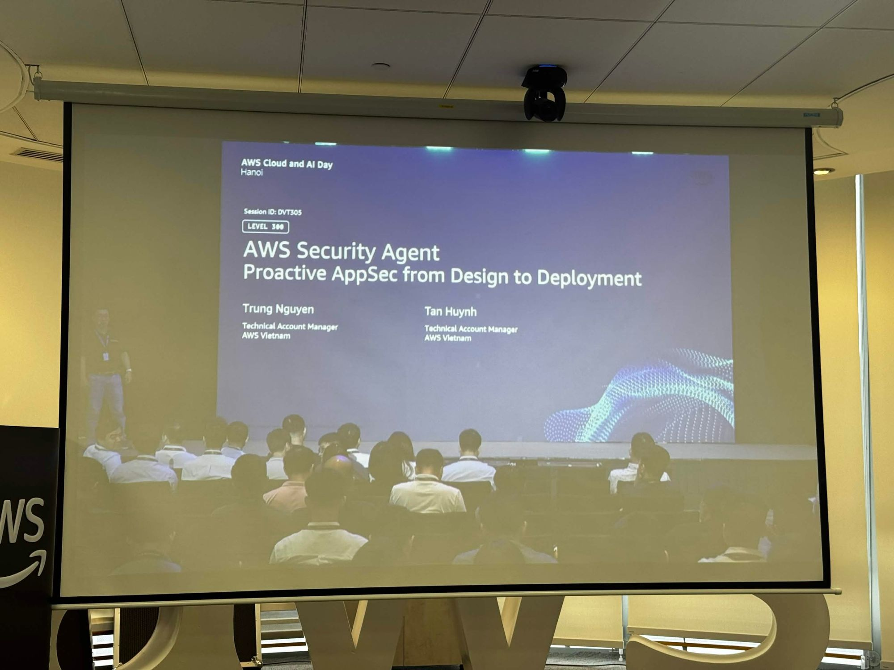
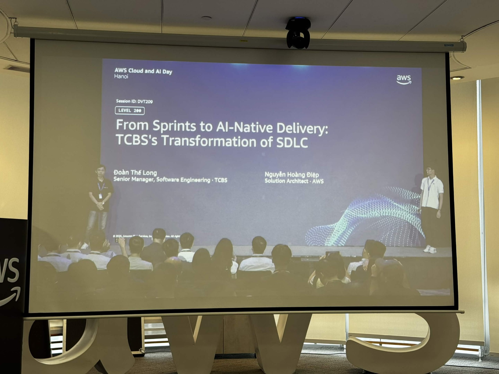

### Tổng Hợp Thu Hoạch

| | |
|---|---|
| **Thời gian** | 08:30 – 17:00, ngày 29/09/2026 |
| **Đơn vị tổ chức** | Amazon Web Services Viet Nam Company Limited |
| **Địa điểm** | Tầng 26, tòa nhà Bitexco, số 02 đường Hải Triều, phường Sài Gòn, thành phố Hồ Chí Minh |
| **Vai trò** | Người tham dự |

---

### 1. Mục Đích Của Sự Kiện

AWS Cloud and AI Day giới thiệu những góc nhìn mới nhất về xu hướng Cloud Computing và Artificial Intelligence (AI), cùng các giải pháp công nghệ đang được ứng dụng ở Việt Nam và trên thế giới.

Qua các phiên keynote, talkshow và chia sẻ chuyên sâu của chuyên gia trong ngành, chương trình nói về vai trò của hạ tầng số, điện toán đám mây, Generative AI và Agentic AI trong chuyển đổi số của doanh nghiệp.

Sự kiện cũng đi vào những vấn đề như bảo mật thông tin, tự động hóa kiểm thử, quản trị AI trong doanh nghiệp và cách phát triển phần mềm trong kỷ nguyên AI.

---

### 2. Danh Sách Diễn Giả

- **Dr. Werner Vogels** – CTO, Amazon.com
- **Dr. Jens Lottner** – CEO, Techcombank
- **Mai Le** – Director of Product Management, Katalon
- **Võ Xuân Minh Tuấn** – Senior Solution Architect, AWS
- **Đại diện Bộ Khoa học và Công nghệ Việt Nam** – Định hướng phát triển hạ tầng số, dữ liệu và AI tại Việt Nam
- **Các đại diện AWS và đối tác công nghệ** – Giải pháp Cloud, AI, bảo mật và ứng dụng thực tế

---

### 3. Nội Dung Nổi Bật

**Định Hướng Hạ Tầng Số Và AI Tại Việt Nam**

- **Hiện trạng hạ tầng số:** Việt Nam có 42 trung tâm dữ liệu thương mại với tổng công suất thiết kế khoảng 372 MW. Độ phủ 4G đạt 99,8% và 5G đạt khoảng 91,9% dân số.
- **Bốn trụ cột chiến lược:** Hạ tầng số, dữ liệu và AI, phát triển nhân lực công nghệ, và xây dựng hệ sinh thái công nghệ toàn diện.
- **Hợp tác cùng AWS:** AWS đã hoàn thành thủ tục cung cấp dịch vụ đám mây tại Việt Nam từ tháng 2/2025 và đưa AWS Local Zones vào vận hành.

**Cloud Và AI Trong Doanh Nghiệp Việt Nam**

- **AMI Group:** Làm PoC AMI Keiji trên Amazon Bedrock và EC2 để truy vết nguồn gốc phân tử của các bệnh mãn tính.
- **Vinasoy:** Dùng Generative AI trên Amazon SageMaker và Bedrock. Tỷ lệ giám sát trưng bày tại điểm bán tăng lên hơn 70%, tỷ lệ đứt hàng giảm 20%, thời gian chấm điểm rút từ hơn 20 ngày xuống dưới 2 ngày.
- **Agris:** Xây nền tảng dữ liệu tập trung trên Amazon Redshift và AWS Glue, giảm 50% thời gian kiểm toán và đối soát.
- **Ngân hàng:** BIDV, VPBank và ACBS dùng Cloud và AI để tự động hóa quy trình nghiệp vụ và phát triển trợ lý ảo hỗ trợ đầu tư.

**Chiến Lược Agentic AI Tại Techcombank (Dr. Jens Lottner)**

- AI không sinh ra để thay thế con người mà để khuếch đại năng lực của con người.
- **Nhân lực:** Mục tiêu là 90% nhân sự biết dùng các công cụ Agentic.
- **AI Coach:** Trợ lý AI giúp nhân viên chọn mô hình phù hợp, tối ưu chi phí và viết prompt tốt hơn.
- **Quản trị:** Cần xác định rõ ROI, có hàng rào an toàn và duy trì cơ chế giám sát.

**Invisible Engineering – Dr. Werner Vogels**

- **Dynamo và NoSQL:** Từ bài toán mở rộng của cơ sở dữ liệu truyền thống, AWS phát triển Dynamo, đặt nền móng cho cơ sở dữ liệu phân tán.
- **AWS Nitro:** Chuyển các tác vụ mạng, lưu trữ và bảo mật sang phần cứng chuyên dụng, giúp tăng bảo mật.
- **Serverless và Lambda:** Cải tiến nhờ Firecracker MicroVM và SnapStart, giảm thời gian khởi động.
- **Distributed Time:** Dùng đồng hồ nguyên tử và hạ tầng mạng riêng để tăng độ chính xác trong hệ thống phân tán.

**Thu Hẹp Khoảng Cách Kiểm Thử Trong Kỷ Nguyên GenAI (Mai Le – Katalon)**

- **Validation Gap:** AI viết code nhanh hơn, nhưng kiểm thử chưa theo kịp.
- **Fragmented Context:** Thông tin về yêu cầu, tài liệu và kết quả kiểm thử nằm rải rác ở nhiều hệ thống.
- **Agentic Workflows:** Đưa AI Agent vào xuyên suốt vòng đời phát triển phần mềm.
- **AI-led, Human-governed:** AI chủ động làm việc, con người đặt giới hạn và chịu trách nhiệm cuối cùng.

**AI Security Agent Và Tự Động Hóa Kiểm Thử Bảo Mật**

- **Khoảng cách bảo mật:** Phần mềm ra mắt nhanh nhưng kiểm thử bảo mật chậm hơn.
- **AI Security Agent:** Hỗ trợ đánh giá tài liệu thiết kế, phân tích nguy cơ, rà soát mã nguồn và kiểm thử bảo mật.
- **Chạy song song:** Rút ngắn thời gian kiểm thử so với cách làm thủ công.

**AI-driven Development Lifecycle Và Tương Lai Phần Mềm**

- **AI Assistant → AI Agents → Autonomous Agents:** Từ gợi ý code đến thực hiện trọn một tác vụ.
- **AI-DLC:** Ba giai đoạn Inception, Construction và Operation nối thành một quy trình thống nhất.
- **Spec-Driven Development:** Dùng bản đặc tả chi tiết để AI hiểu đúng yêu cầu.
- **Kiro và Agent Client Protocol:** Môi trường phát triển hỗ trợ Agent, kết nối và điều phối các công cụ AI.

**Quản Trị AI Với Amazon Q (Võ Xuân Minh Tuấn – AWS)**

- **Shadow AI:** Nhân viên tự dùng công cụ AI bên ngoài gây rủi ro bảo mật và làm dữ liệu bị phân tán.
- **Amazon Q Business:** Kết nối với dữ liệu nội bộ để nhân viên khai thác thông tin.
- **Amazon QuickSight:** Generative BI cho phép đặt câu hỏi bằng ngôn ngữ tự nhiên.
- **Amazon Bedrock Agent Core Runtime:** Môi trường chạy tách biệt để kiểm soát các tác vụ của AI Agent.

---

### 4. Những gì học được

Qua Dynamo, Nitro, Lambda và Firecracker, mình thấy hiệu năng, bảo mật và khả năng mở rộng đến từ thiết kế kiến trúc. Cloud giảm gánh nặng quản lý hạ tầng và là nền để xây hệ thống có thể mở rộng. Agentic AI là ý lớn thứ hai: các AI Agent có thể phối hợp làm một quy trình phức tạp, thay vì chỉ trả lời từng lệnh riêng lẻ.

Từ các phiên của Katalon và AWS Security Agent, mình rút ra rằng kiểm thử và bảo mật phải chạy xuyên suốt quá trình phát triển, không chỉ ở bước cuối, vì AI viết code nhanh hơn khả năng kiểm tra của con người. Spec-Driven Development đi cùng ý đó: xác định yêu cầu và viết đặc tả rõ ràng trước khi làm việc với AI.

Phiên quản trị AI nêu những thứ cần kiểm soát khi nhân viên dùng AI: dữ liệu, chi phí, quyền truy cập và kết quả do AI tạo ra. Giá trị của AI nằm ở kết quả nó mang lại, và người dùng vẫn phải đánh giá, kiểm chứng và chịu trách nhiệm về kết quả đó.

---

### 5. Ứng dụng vào công việc

- Mình sẽ dùng AI Agent để phân tích yêu cầu, dựng cấu trúc dự án, viết code và tạo test case, bắt đầu từ một đặc tả viết rõ.
- Mình sẽ viết unit test, kiểm tra các trường hợp ngoại lệ và xác thực kết quả do AI tạo ra.
- Mình sẽ quản lý thông tin xác thực, quyền truy cập và bảo vệ dữ liệu.
- Mình sẽ học thêm về Amazon Bedrock, AWS Lambda, Amazon S3 và các công cụ xây AI Agent.

---

### 6. Trải nghiệm trong event

Mình tham dự cả ngày, từ 08:30 đến 17:00. Phần keynote của Dr. Werner Vogels về Invisible Engineering là phần mình nhớ nhất. Những câu chuyện về Dynamo, Nitro và Serverless cho thấy phía sau một dịch vụ ổn định là rất nhiều cải tiến kỹ thuật liên tục. Dr. Jens Lottner nói về Agentic AI tại Techcombank như một cách khuếch đại năng lực của con người, chứ không có ý thay thế con người.

Các case study của Vinasoy, Agris và AMI Group cho mình thấy Cloud và AI được dùng ở nhiều lĩnh vực. Mỗi doanh nghiệp bắt đầu từ bài toán riêng rồi mới chọn công nghệ. Câu "Now go build" của Dr. Werner Vogels nhắc mình đừng dừng ở lý thuyết mà bắt tay vào làm.

---

### 7. Bài học rút ra

Cloud và AI chỉ có ý nghĩa khi giải được một vấn đề cụ thể và cho kết quả rõ ràng. AI giúp phát triển nhanh hơn, nhưng kiểm thử và bảo vệ dữ liệu vẫn bắt buộc. Con người vẫn đặt yêu cầu, kiểm soát kết quả và chịu trách nhiệm về sản phẩm cuối cùng.

---

### 8. Một Số Hình Ảnh Khi Tham Gia Sự Kiện

