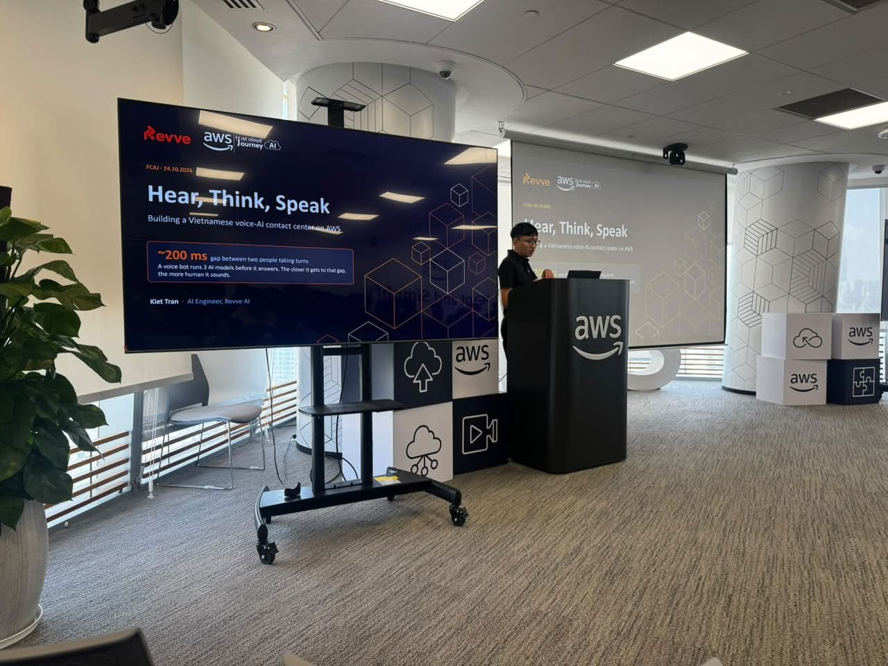
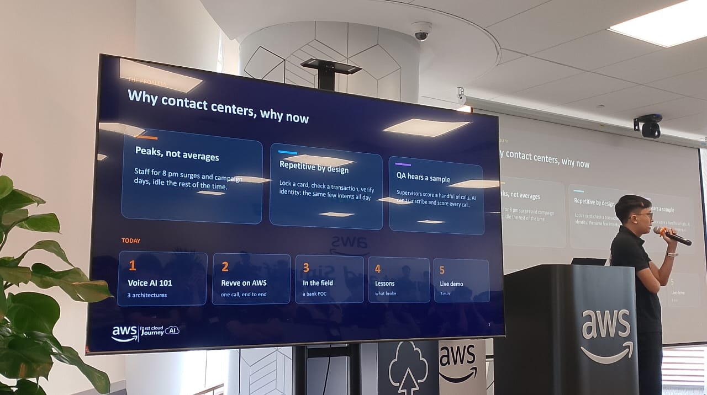
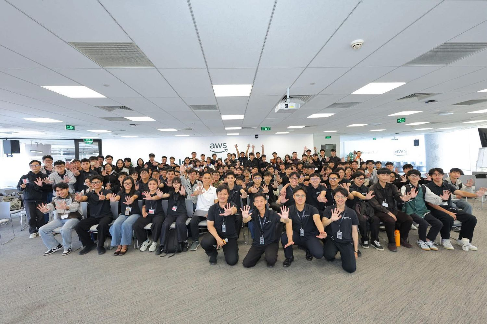

### Tổng Hợp Thu Hoạch

| | |
|---|---|
| **Thời gian** | 09:00 – 12:00, ngày 24/10/2026 |
| **Đơn vị tổ chức** | AWS Study Group |
| **Địa điểm** | Tầng 26, tòa nhà Bitexco, số 02 đường Hải Triều, phường Sài Gòn, thành phố Hồ Chí Minh |
| **Vai trò** | Người tham dự |

---

### 1. Mục Đích Của Sự Kiện

Buổi Meet Up First Cloud AI Journey nói về tiềm năng của Voice AI và các mô hình hội thoại thời gian thực, và cách xây dựng hệ thống trò chuyện với con người bằng giọng nói.

Buổi Meet Up diễn ra trong 3 giờ với 5 session: Voice AI contact center, chia sẻ tài nguyên bằng AWS Resource Access Manager, kiểm thử bảo mật bằng AWS Security Agent, Amazon Bedrock AgentCore và Kiro Crew.

Chương trình đi qua các kiến trúc Voice AI, bài toán độ trễ khi giao tiếp bằng giọng nói, và cách kiểm duyệt nội dung (Guardrails) trước khi AI trả lời. Cuối session đầu có demo một trợ lý tuyển dụng AI tự động gọi điện sơ tuyển ứng viên. Các session sau chuyển sang quản trị nhiều tài khoản, đánh giá an toàn hạ tầng và đưa AI Agent lên production.

---

### 2. Danh Sách Diễn Giả

- **Kiệt Trần** – Revve AI – Session 1: kiến trúc Voice AI / Contact Center, Guardrails và demo trợ lý tuyển dụng AI
- **Long Huỳnh** – Styl Solution – Session 2: AWS Resource Access Manager
- **Thịnh Nguyễn** – Styl Solution – Session 3: AWS Pentest với AWS Continuum / Security Agent
- **Xuân An** – Leader AWS Student Builder Group HCMUTE – Session 4: Amazon Bedrock AgentCore
- **Khoa Kiều** (Tech Lead ACB) và **Nghi Danh** (AWS Community Builder) – Session 5: Kiro Crew
- **Ban tổ chức AWS Study Group** – Điều phối chương trình, hỏi đáp và mini-game

---

### 3. Nội Dung Nổi Bật

#### Session 1: Hear, Think, Speak – Xây dựng contact center Voice AI tiếng Việt trên AWS

**Độ Trễ Khi Nói Chuyện Bằng Giọng Nói**

- Khi hai người nói chuyện, thời gian phản hồi lý tưởng khoảng **200 ms**.
- Hệ thống Voice AI cần trả lời đủ nhanh để người nghe không thấy khó chịu.
- Kiến trúc được giới thiệu đưa độ trễ xuống khoảng **1,8 giây** để cuộc trò chuyện đủ mượt.

**Ba Mô Hình Kiến Trúc Voice AI**

- **Cascade (STT → LLM → TTS):** giọng nói được chuyển thành văn bản, LLM xử lý và trả lời, rồi văn bản được chuyển lại thành giọng nói.
  - Ưu điểm: linh hoạt, dễ thay từng module.
  - Nhược điểm: độ trễ cộng dồn qua các bước, có thể vượt 500 ms – 1 giây.
- **Speech-to-Speech thế hệ cũ:** chuyển trực tiếp âm thanh vào thành âm thanh ra.
  - Ưu điểm: rất nhanh.
  - Nhược điểm: chỉ hợp tác vụ đơn giản, khó kiểm soát logic ngữ nghĩa sâu.
- **Full Speech-to-Speech thế hệ mới:** kết hợp khả năng hiểu của LLM với mô hình âm thanh đa phương thức, giảm độ trễ mà vẫn giữ được cảm xúc và ngữ điệu tự nhiên.

**Tích Hợp Vào Contact Center**

- Khó khăn khi nối các mô hình AI với hạ tầng tổng đài có sẵn (SIP trunking, WebRTC, telephony).

**Guardrails Trong Voice AI**

- Nội dung do LLM tạo ra cần được kiểm duyệt **trước khi** chuyển thành giọng nói.
- Mục tiêu là ngăn ảo giác (hallucination), nội dung nhạy cảm, nội dung sai chính sách của doanh nghiệp và thông tin độc hại.
- Thiết lập nhiều tầng bảo vệ trên AWS để trợ lý luôn đi đúng kịch bản kinh doanh.

**Demo Trợ Lý Tuyển Dụng AI "Mai"**

- Kịch bản: trợ lý "Mai" đại diện công ty "Mê Xanh" gọi điện sơ tuyển ứng viên vị trí **AWS Cloud Engineer**.
- Luồng xử lý: tự động quay số → nhận diện giọng nói của ứng viên → LLM đánh giá câu trả lời theo tiêu chí tuyển dụng → sinh câu hỏi tiếp theo theo thời gian thực → lưu kết quả vào CRM/Database.
- Trong demo, AI hỏi về kinh nghiệm với AWS (EC2, S3, IAM, Lambda) và mức độ sẵn sàng làm việc, rồi kết thúc cuộc gọi lịch sự.
- Sau cuộc gọi có log transcript, điểm đánh giá kỹ năng sơ bộ và báo cáo gửi cho đội nhân sự.

**Thảo Luận Kỹ Thuật**

- Chọn SDK và công cụ cho luồng âm thanh thời gian thực.
- So sánh chi phí vận hành giữa các mô hình LLM và dịch vụ chuyển đổi giọng nói.
- Quản lý trạng thái hội thoại trong cuộc gọi dài và phức tạp.
- Kết nối AI agent với hệ thống backend của doanh nghiệp qua Function Calling / Tool Use.

#### Session 2: AWS Resource Access Manager

- Chia sẻ tài nguyên an toàn giữa các tài khoản trong cùng AWS Organization, không phải tạo bản sao ở từng tài khoản.
- Cách làm này tiết kiệm chi phí và gom việc quản trị mạng về một chỗ.
- Kết hợp IAM policy với SCP để không tài khoản hay người dùng nào vượt quá trần quyền hạn đã đặt.

#### Session 3: AWS Pentest với AWS Continuum / Security Agent

- Đánh giá an toàn hạ tầng từ sớm, ngay trong quy trình phát triển.
- Review code Terraform và gắn trực tiếp vào Pull Request trên GitLab/GitHub để bắt lỗi trước khi merge.
- Security Agent đóng vai người dùng thực để pentest tự động trên môi trường SIT/UAT trước khi deploy thật.

#### Session 4: Amazon Bedrock AgentCore

- Hai nền tảng đưa Agent lên production: **Agent Runtime** và hệ thống **Memory**.
- Agent Runtime chạy trên MicroVM dùng EC2 Spot, giúp tiết kiệm chi phí.
- Memory chia hai tầng: Short-term (đồng bộ) và Long-term (bất đồng bộ), để Agent hiểu sâu ngữ cảnh người dùng.

#### Session 5: Kiro Crew

Bài toán là cho AI Agent chạy 24/7 để hỗ trợ review code và kiểm tra hệ thống. Phần hỏi đáp kỹ thuật cuối giờ có ba nội dung đáng chú ý:

- **Artifacts:** Kiro Crew tự động lấy dữ liệu việc làm thực tế và dựng biểu đồ thống kê ngay trong khung chat.
- **Quản trị Context Window:** cơ chế Auto Compact chạy khi ngữ cảnh chạm ngưỡng 70–90%, và tính năng Break down context để xem lượng token của từng thành phần.
- **Memory và Guardrails:** dọn memory cũ để chi phí không phình lên; đặt lớp chặn bảo mật để AI không tự ý xóa hạ tầng hay làm lộ secret/credential của máy chủ.

---

### 4. Những Gì Học Được

**Tư Duy Thiết Kế**

- **Bắt đầu từ người nghe:** Bài toán Voice AI bắt đầu từ **độ trễ** và **trải nghiệm của người nghe**, sau đó mới đến chọn công nghệ.
- **Mỗi kiến trúc có đánh đổi:** Mỗi mô hình cân bằng giữa tốc độ, độ linh hoạt và khả năng kiểm soát.
- **Guardrails là bắt buộc:** Đây là một tầng cần có ngay từ đầu, không phải thứ thêm vào sau.

**Kiến Trúc Kỹ Thuật**

- **Độ trễ cộng dồn:** Mình hiểu luồng STT → LLM → TTS và vì sao độ trễ cộng dồn qua từng bước.
- **Function calling / tool use:** Mình hiểu vai trò của nó khi AI agent cần làm việc với hệ thống thật.
- **Đưa vào tổng đài:** Mình biết cần tính đến telephony, quản lý trạng thái hội thoại và chi phí khi đưa Voice AI vào tổng đài.

**Quản Trị Và Bảo Mật**

- **Chia sẻ thay vì sao chép:** Mình hiểu AWS RAM cho phép dùng chung tài nguyên giữa các tài khoản, và SCP đặt trần quyền hạn cho cả tổ chức bên trên IAM policy.
- **Kiểm tra bảo mật sớm:** Mình thấy lỗi hạ tầng có thể bị bắt ngay ở bước review Terraform hoặc Pull Request, thay vì sau khi đã deploy.

**Agent Trên Production**

- **Agent cần runtime và memory riêng:** Mình biết AgentCore tách phần chạy Agent (Runtime) khỏi phần nhớ ngữ cảnh (Memory ngắn hạn và dài hạn).
- **Ngữ cảnh và memory tốn chi phí:** Context window và memory cũ đều làm tăng lượng token, nên cần Auto Compact và dọn dẹp định kỳ.
- **Guardrails ở tầng hạ tầng:** Ngoài kiểm duyệt nội dung, Agent còn cần lớp chặn để không xóa hạ tầng hay làm lộ credential.

**Ứng Dụng Thực Tế**

- **Tự động hóa từ đầu đến cuối:** Mình thấy một quy trình nghiệp vụ (sơ tuyển ứng viên) được AI agent làm trọn vẹn.
- **Con người quyết định cuối cùng:** Kết quả cuộc gọi được lưu lại và báo cáo để con người ra quyết định.

---

### 5. Ứng Dụng Vào Công Việc

- **Kiểm duyệt trước khi phản hồi:** Khi thiết kế ứng dụng có AI, mình sẽ cân nhắc Guardrails ngay từ đầu.
- **Ước tính chi phí sớm:** Khi học thêm các dịch vụ AWS, mình sẽ ước tính **chi phí** của các thành phần AI (mô hình, chuyển đổi giọng nói) trước khi triển khai.
- **Hiểu cách agent nối với hệ thống:** Mình sẽ tìm hiểu thêm về function calling / tool use để biết AI agent kết nối với hệ thống backend như thế nào.
- **Giới hạn quyền cho từng thành phần:** Với Cost Guard, mình sẽ giữ nguyên tắc mỗi hàm Lambda một IAM role chỉ có quyền dừng đúng instance đích, giống ý tưởng đặt trần quyền hạn ở session 2 và lớp chặn không cho Agent xóa hạ tầng ở session 5.

---

### 6. Trải Nghiệm Trong Event

Mình tham dự trực tiếp buổi Meet Up từ 9 giờ đến 12 giờ trưa ngày 24/10/2026 tại Tầng 26, tòa nhà Bitexco, do cộng đồng AWS Study Group tổ chức. Buổi gồm 5 session, mở đầu là Voice AI và Agentic AI trong Contact Center.

**Học Từ Diễn Giả**

Anh Kiệt Trần (Revve AI) giải thích rõ các kiến trúc Voice AI và vì sao độ trễ quyết định trải nghiệm. Phần Guardrails giúp mình hiểu rằng một trợ lý AI cần được kiểm soát nội dung trước khi nói với người dùng.

Hai anh của Styl Solution nói về chia sẻ tài nguyên và kiểm thử bảo mật, anh Xuân An giới thiệu AgentCore. Session cuối về Kiro Crew là phần mình quan tâm nhất, vì nó nói đến việc cho AI Agent chạy liên tục mà vẫn kiểm soát được chi phí và quyền hạn.

**Phần Demo Thực Tế**

Mình được xem trợ lý tuyển dụng "Mai" gọi điện sơ tuyển ứng viên và thấy kết quả được ghi lại, chấm điểm sơ bộ. Phần thảo luận kỹ thuật cho mình biết thêm những vấn đề thật khi xây Voice AI, như chi phí, quản lý trạng thái hội thoại và kết nối hệ thống backend.

**Kết Nối Và Trao Đổi**

Phần hỏi đáp và mini-game cuối buổi giúp mình ôn lại kiến thức về dịch vụ AWS, mô hình ngôn ngữ và kiến trúc hội thoại.

---

### 7. Bài Học Rút Ra

- **AI có kiểm soát mới hữu ích:** AI agent chỉ có ích trong thực tế khi được kiểm soát (Guardrails) và nối được với hệ thống nghiệp vụ.
- **Cân bằng là một phần của thiết kế:** Khi chọn kiến trúc Voice AI, cần cân bằng giữa độ trễ, chi phí và khả năng kiểm soát.
- **Bắt đầu từ người dùng:** Chọn công nghệ xuất phát từ trải nghiệm của người nghe, không phải ngược lại.
- **Quyền hạn và chi phí cần giới hạn từ đầu:** Từ SCP ở session 2 đến Guardrails và quản lý memory ở session 5, ý chung là đặt trần cho quyền hạn và chi phí trước khi hệ thống chạy.

---

### 8. Một Số Hình Ảnh Khi Tham Gia Sự Kiện

