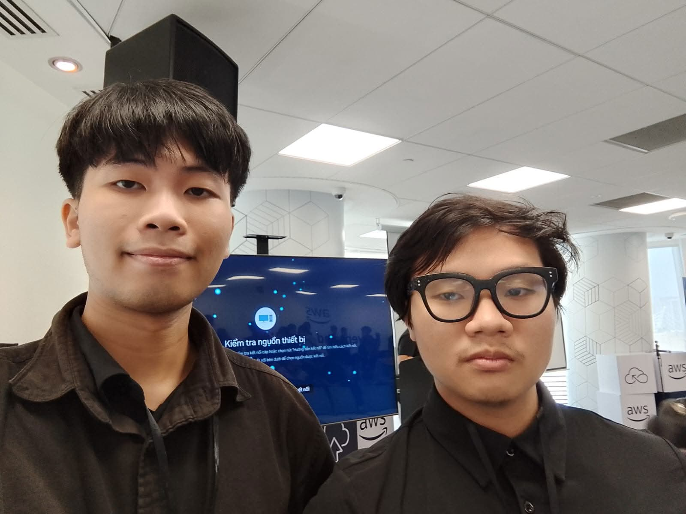

# Bài thu hoạch "BUỔI MEET UP ĐẦY NĂNG LƯỢNG: FIRST CLOUD AI JOURNEY"

| | |
|---|---|
| **Thời gian** | 09:00 – 12:00, ngày 24/10/2026 |
| **Đơn vị tổ chức** | AWS Study Group |
| **Địa điểm** | Tầng 26, Tòa nhà Bitexco, 02 Hải Triều, Phường Sài Gòn, TP. Hồ Chí Minh |
| **Vai trò** | Người tham dự |

---

### Mục Đích Của Sự Kiện

- Tìm hiểu tiềm năng của Voice AI và các mô hình hội thoại thời gian thực (real-time Voice AI)
- Hiểu các kiến trúc xây dựng hệ thống Voice AI và bài toán độ trễ trong giao tiếp
- Tìm hiểu cách kiểm duyệt nội dung (Guardrails) trước khi AI trả lời bằng giọng nói
- Xem demo trợ lý tuyển dụng AI tự động gọi điện sơ tuyển ứng viên

---

### Danh Sách Diễn Giả

- **Kiệt Trần** – Reai – Diễn giả chính: kiến trúc Voice AI / Contact Center, Guardrails và demo trợ lý tuyển dụng AI
- **Ban tổ chức AWS Study Group** – Điều phối chương trình, hỏi đáp và mini-game

---

### Nội Dung Nổi Bật

#### Độ trễ trong giao tiếp bằng giọng nói

- Trong hội thoại tự nhiên giữa người với người, thời gian phản hồi lý tưởng khoảng **200 ms**
- Hệ thống Voice AI cần phản hồi đủ nhanh để người nghe không thấy khó chịu

#### 3 mô hình kiến trúc Voice AI

- **Cascade (STT → LLM → TTS):** chuyển giọng nói thành văn bản, LLM xử lý và trả lời, rồi chuyển văn bản thành giọng nói
  - Ưu điểm: linh hoạt, dễ thay từng module
  - Nhược điểm: độ trễ cộng dồn qua các bước tuần tự, có thể vượt 500 ms – 1 giây
- **Speech-to-Speech thế hệ cũ:** chuyển trực tiếp âm thanh vào thành âm thanh ra
  - Ưu điểm: rất nhanh
  - Nhược điểm: chỉ phù hợp tác vụ đơn giản, khó kiểm soát logic ngữ nghĩa sâu
- **Full Speech-to-Speech thế hệ mới:** kết hợp khả năng hiểu của LLM với mô hình âm thanh đa phương thức, giảm độ trễ và giữ được cảm xúc, ngữ điệu tự nhiên

#### Tích hợp vào Contact Center

- Thách thức khi nối các mô hình AI với hạ tầng tổng đài sẵn có (SIP trunking, WebRTC, telephony)

#### Guardrails trong Voice AI

- Nội dung do LLM tạo ra cần được kiểm duyệt **trước khi** chuyển thành giọng nói
- Mục tiêu: ngăn ảo giác (hallucination), nội dung nhạy cảm, sai lệch chính sách doanh nghiệp, thông tin độc hại
- Thiết lập nhiều tầng bảo vệ (safety layers) trên AWS để trợ lý luôn đi đúng kịch bản kinh doanh

#### Demo trợ lý tuyển dụng AI "Mai"

- Kịch bản: trợ lý "Mai" đại diện công ty "Mê Xanh" gọi điện sơ tuyển ứng viên vị trí **AWS Cloud Engineer**
- Luồng xử lý: tự động quay số → nhận diện giọng nói ứng viên → LLM phân tích câu trả lời theo tiêu chí tuyển dụng → sinh câu hỏi tiếp theo theo thời gian thực → lưu kết quả vào CRM/Database
- Trong demo, AI hỏi về kinh nghiệm với AWS (EC2, S3, IAM, Lambda) và mức độ sẵn sàng làm việc, rồi kết thúc cuộc gọi lịch sự
- Sau cuộc gọi có log transcript, điểm đánh giá kỹ năng sơ bộ và báo cáo gửi cho đội nhân sự

#### Thảo luận kỹ thuật

- Lựa chọn SDK/công cụ cho luồng âm thanh thời gian thực
- So sánh chi phí vận hành giữa các mô hình LLM và dịch vụ chuyển đổi giọng nói
- Quản lý trạng thái hội thoại trong cuộc gọi dài, phức tạp
- Kết nối AI agent với hệ thống backend doanh nghiệp qua Function Calling / Tool Use

---

### Những Gì Học Được

**Tư Duy Thiết Kế**

- Bài toán Voice AI bắt đầu từ **độ trễ** và **trải nghiệm người nghe**, rồi mới đến lựa chọn công nghệ
- Mỗi mô hình kiến trúc đều có đánh đổi giữa tốc độ, độ linh hoạt và khả năng kiểm soát
- Guardrails là một tầng bắt buộc, không phải phần thêm vào sau

**Kiến Trúc Kỹ Thuật**

- Hiểu luồng STT → LLM → TTS và vì sao độ trễ cộng dồn
- Hiểu vai trò của function calling / tool use khi AI agent cần làm việc với hệ thống thật
- Biết các vấn đề cần tính khi đưa Voice AI vào tổng đài: telephony, quản lý trạng thái hội thoại, chi phí

**Ứng Dụng Thực Tế**

- Thấy một quy trình nghiệp vụ (sơ tuyển ứng viên) được tự động hóa từ đầu đến cuối bằng AI agent
- Thấy cách kết quả cuộc gọi được lưu lại và báo cáo để con người ra quyết định

---

### Ứng Dụng Vào Công Việc

- Dùng tư duy **kiểm duyệt trước khi phản hồi** khi thiết kế các ứng dụng có AI: cân nhắc Guardrails ngay từ đầu
- Khi học tiếp các dịch vụ AWS, chú ý ước tính **chi phí** của các thành phần AI (mô hình, chuyển đổi giọng nói) trước khi triển khai
- Tìm hiểu thêm về function calling / tool use để hiểu cách AI agent kết nối với hệ thống backend

---

### Trải Nghiệm Trong Event

Tôi tham gia trực tiếp buổi **BUỔI MEET UP ĐẦY NĂNG LƯỢNG: FIRST CLOUD AI JOURNEY** từ 9 giờ đến 12 giờ trưa ngày 24/10/2026 tại Tầng 26, tòa nhà Bitexco, do cộng đồng AWS Study Group tổ chức. Chủ đề chính của buổi là Voice AI và Agentic AI trong Contact Center.

**Học hỏi từ diễn giả**

Anh Kiệt Trần (Reai) giải thích rõ các kiến trúc Voice AI và vì sao độ trễ là yếu tố quyết định trải nghiệm. Phần về Guardrails giúp mình hiểu rằng một trợ lý AI cần được kiểm soát nội dung trước khi nói với người dùng.

**Trải nghiệm demo thực tế**

Được xem trực tiếp trợ lý tuyển dụng "Mai" gọi điện sơ tuyển ứng viên và nhìn thấy kết quả được ghi lại, chấm điểm sơ bộ. Phần thảo luận kỹ thuật giúp mình biết các vấn đề thực tế khi xây dựng Voice AI như chi phí, quản lý trạng thái hội thoại và kết nối hệ thống backend.

**Kết nối và trao đổi**

Phần hỏi đáp và mini-game cuối buổi giúp ôn lại kiến thức về dịch vụ AWS, mô hình ngôn ngữ và kiến trúc hội thoại.

**Bài học rút ra**

- AI agent chỉ hữu ích trong thực tế khi được kiểm soát (Guardrails) và nối được với hệ thống nghiệp vụ.
- Cần cân bằng giữa độ trễ, chi phí và khả năng kiểm soát khi chọn kiến trúc Voice AI.

---

### Một Số Hình Ảnh Khi Tham Gia Sự Kiện

