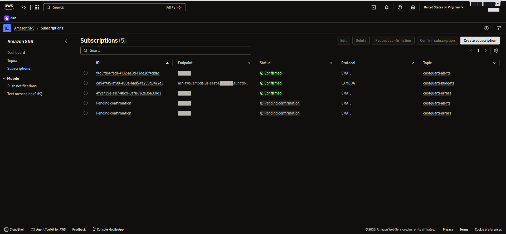
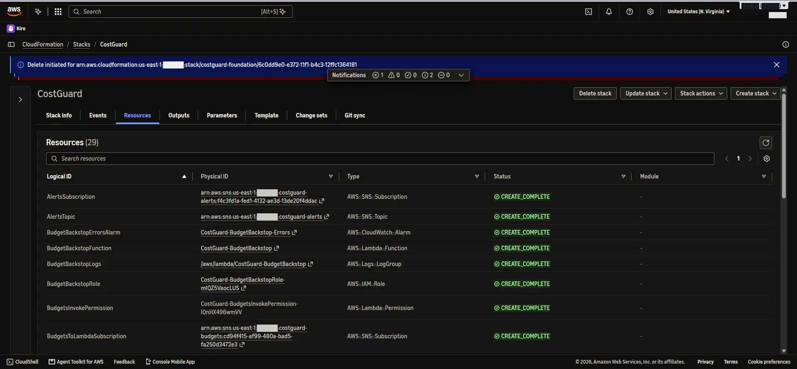
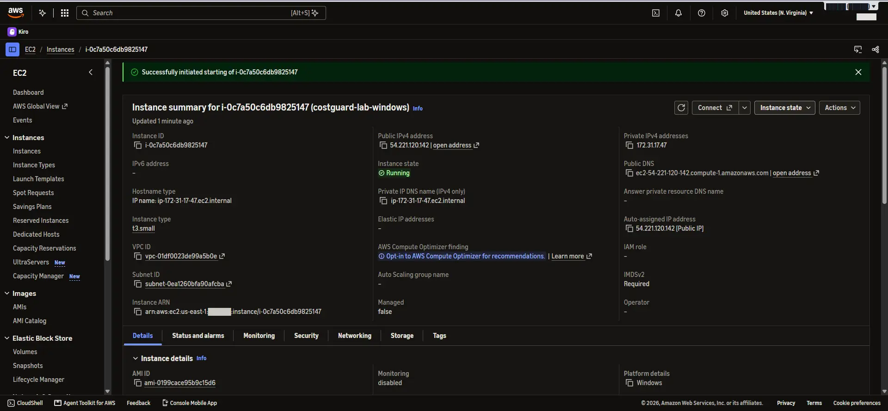

## Triển khai nền tảng

Ở bước này bạn deploy một CloudFormation stack để tạo máy lab và mọi thứ mà ba lớp dùng chung: cấu hình, dữ liệu, thông báo và IAM role. Chính ba lớp được giải thích và kiểm thử ở 5.4, 5.5 và 5.6.

### Stack tạo những gì

- **Máy lab:** một instance Windows Server 2022 `t3.small` với ổ gốc gp3 30 GB, gắn tag `Project=CostGuard`. Nếu bạn truyền `ExistingInstanceId`, stack sẽ bảo vệ instance đó thay vì tạo máy mới.
- **Parameter Store:** `/costguard/instance-id`, `/costguard/price-per-hour`, `/costguard/cost-threshold` và `/costguard/budget-limit`.
- **DynamoDB:** bảng `CostGuardSessions` ở chế độ on-demand, khóa phân vùng `instance_id` và khóa sắp xếp `timestamp`.
- **SNS:** các topic `costguard-alerts`, `costguard-errors` và `costguard-budgets`. Email của bạn đăng ký hai topic đầu.
- **IAM:** một role cho từng hàm Lambda, cộng một role cho EventBridge Scheduler.
- **Lambda, lịch, Budget, alarm:** được tạo ở đây và mô tả ở 5.4–5.6.

### Tham số

- `AlertEmail` (bắt buộc): hộp thư nhận cảnh báo.
- `ExistingInstanceId`: để trống để tạo máy lab mới.
- `PricePerHour`: mặc định 0.0392. Đây là đơn giá theo giờ của instance trong Pricing Calculator.
- `CostThreshold`: mặc định 14, khoảng 70% ngân sách.
- `BudgetLimit`: mặc định 20.
- `StopCron` và `StopScheduleTimezone`: mặc định `cron(0 22 * * ? *)` và `Asia/Ho_Chi_Minh`.
- `CostMeterRateMinutes`: mặc định 5.

### Bước 1 – Tạo stack

**Console**

1. Mở **CloudFormation** ở `us-east-1` và chọn **Create stack → With new resources**.
2. Chọn **Upload a template file** và chọn `cost-guard.yaml`.
3. Đặt tên stack là `CostGuard`.
4. Nhập email của bạn vào `AlertEmail`. Giữ nguyên các tham số khác.
5. Ở trang cuối, tick **I acknowledge that AWS CloudFormation might create IAM resources**, rồi chọn **Submit**.

**AWS CLI**

```bash
aws cloudformation deploy \
  --region us-east-1 \
  --stack-name CostGuard \
  --template-file cost-guard.yaml \
  --capabilities CAPABILITY_IAM \
  --parameter-overrides AlertEmail=you@example.com
```

### Bước 2 – Xác nhận đăng ký email

1. Mở hộp thư. Bạn nhận hai thư từ Amazon SNS, một cho `costguard-alerts` và một cho `costguard-errors`.
2. Chọn **Confirm subscription** trong từng thư. Khi chưa xác nhận, SNS sẽ không gửi gì tới địa chỉ đó.



### Bước 3 – Kiểm tra kết quả

1. Khi trạng thái stack là **CREATE_COMPLETE**, mở tab **Outputs**. `ProtectedInstanceId` là instance mà Cost Guard bảo vệ.
2. Kiểm tra từng tài nguyên trong console tương ứng:
   - **EC2:** instance `CostGuard-Lab` đang chạy.
   - **Systems Manager → Parameter Store:** có bốn tham số `/costguard/`.
   - **DynamoDB:** bảng `CostGuardSessions` ở trạng thái active.
   - **SNS:** có ba topic, và hai đăng ký đầu hiện **Confirmed**.
   - **Lambda:** có `CostGuard-ScheduleHandler`, `CostGuard-CostMeter` và `CostGuard-BudgetBackstop`.
   - **EventBridge → Scheduler:** `costguard-daily-stop` và `costguard-cost-meter` đang bật.





**Kết quả trả về:** mọi tài nguyên đều có mặt và máy đang chạy. Máy đã bắt đầu tính tiền, nên hãy sang 5.4 ngay, không nghỉ lâu.
