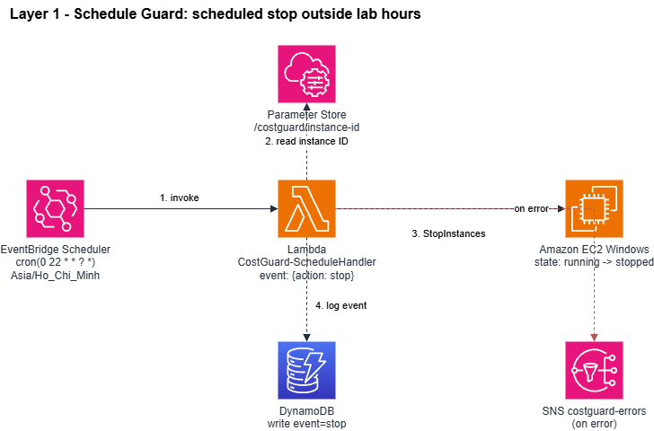
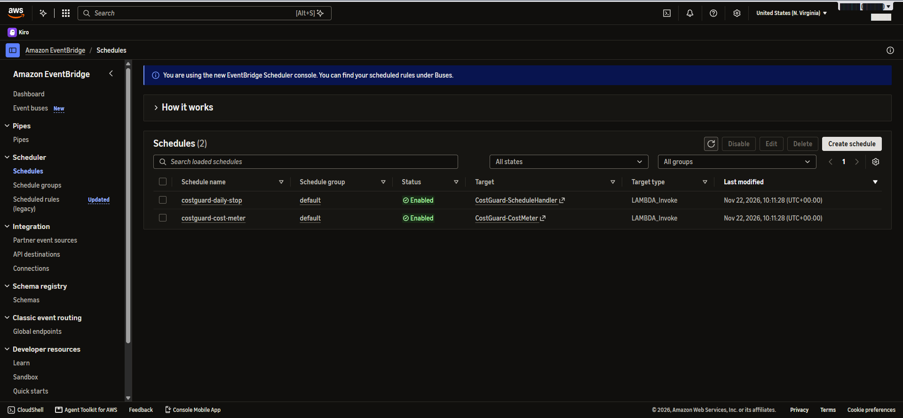
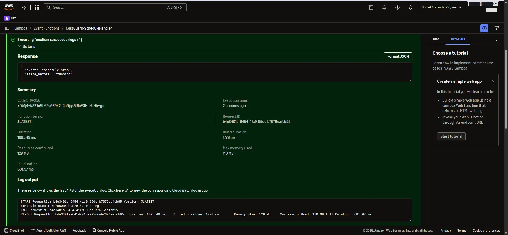
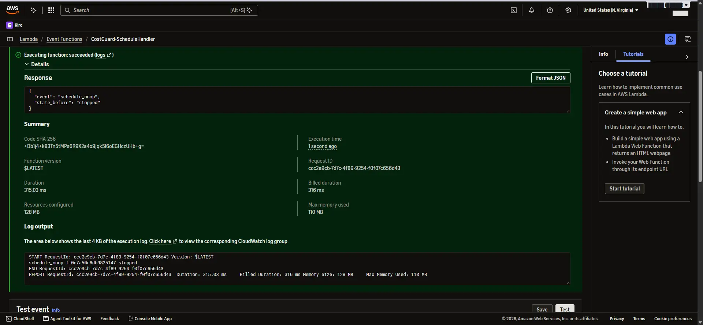
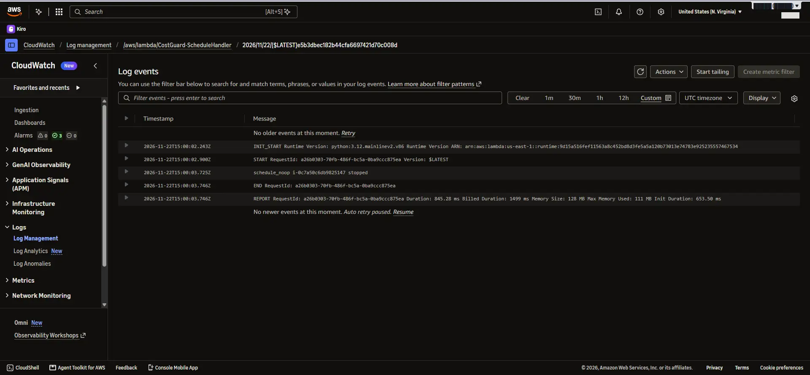
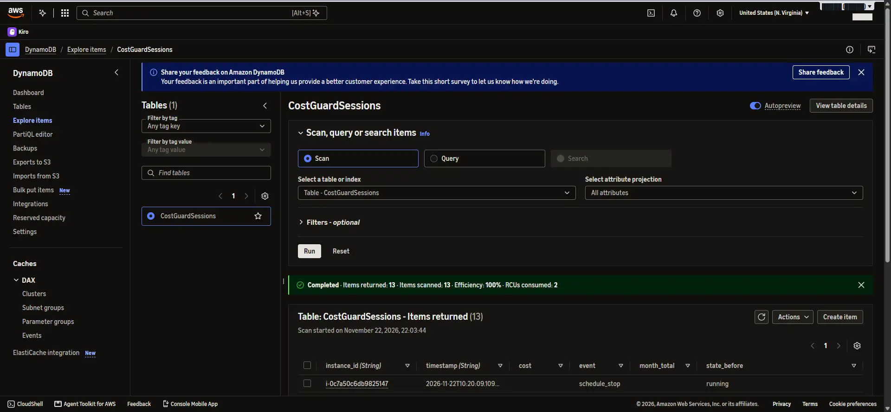

## Lớp 1 – Schedule Guard

Lớp 1 dừng máy lab vào một giờ cố định mỗi ngày. Lớp này không đọc dữ liệu chi phí hay billing, nên là lớp đáng tin cậy nhất trong ba lớp.



### Cách hoạt động

1. **EventBridge Scheduler** gọi hàm Lambda `CostGuard-ScheduleHandler` mỗi ngày lúc 22:00 (múi giờ `Asia/Ho_Chi_Minh`), với sự kiện `{"action": "stop"}`.
2. Hàm đọc instance ID từ `/costguard/instance-id`.
3. Hàm gọi `DescribeInstances`. Nếu instance đang `running` thì gọi `StopInstances`. Ở các trạng thái khác, hàm không làm gì, nên gọi lặp lại vẫn an toàn.
4. Hàm ghi một bản ghi vào `CostGuardSessions` (`schedule_stop` hoặc `schedule_noop`).
5. Nếu có lỗi, hàm gửi lỗi tới `costguard-errors` và ném lại lỗi, để CloudWatch alarm ở 5.6 nhìn thấy.

Lịch chỉ **dừng** máy. Việc bật máy vẫn làm thủ công, nên không tốn credit khi không ai dùng lab.

### Vì sao dùng EventBridge Scheduler

**Rule** của EventBridge đọc biểu thức cron theo UTC, nên giờ dừng 22:00 ở Việt Nam phải viết thành 15:00. EventBridge Scheduler nhận được múi giờ, nên biểu thức bên dưới nói đúng điều nó muốn nói. Scheduler cũng gọi hàm qua role riêng của nó, nên hàm không cần thêm resource-based permission.

```yaml
StopSchedule:
  Type: AWS::Scheduler::Schedule
  Properties:
    Name: costguard-daily-stop
    ScheduleExpression: !Ref StopCron                       # mặc định cron(0 22 * * ? *)
    ScheduleExpressionTimezone: !Ref StopScheduleTimezone   # mặc định Asia/Ho_Chi_Minh
    FlexibleTimeWindow:
      Mode: "OFF"
    Target:
      Arn: !GetAtt ScheduleHandlerFunction.Arn
      RoleArn: !GetAtt SchedulerRole.Arn
      Input: '{"action": "stop"}'
```

### Bước 1 – Xem lịch

1. Mở **EventBridge → Scheduler → Schedules** và chọn `costguard-daily-stop`.
2. Kiểm tra biểu thức cron, múi giờ và target `CostGuard-ScheduleHandler`.



### Bước 2 – Kiểm thử hàm

1. Đảm bảo instance đang **running** (console EC2).
2. Mở **Lambda → CostGuard-ScheduleHandler → Test**. Tạo test event với nội dung `{}` và chọn **Test**.
3. Mở console **EC2** và làm mới.
4. Mở **DynamoDB → Tables → CostGuardSessions → Explore table items**.

**Kết quả trả về:** hàm trả về `schedule_stop` với `state_before` là `running`. Instance chuyển từ `stopping` sang `stopped`. Bảng có thêm một bản ghi với `event = schedule_stop`.



Chạy test lần thứ hai khi instance đang tắt. **Kết quả trả về:** hàm trả về `schedule_noop` và không đụng tới instance.



### Bước 3 – Kiểm thử lịch thật (tùy chọn)

1. Bật lại instance.
2. Mở **CloudFormation → CostGuard → Update**, giữ nguyên template và đổi `StopCron` thành một giờ sau đó vài phút, ví dụ `cron(25 15 * * ? *)` lúc 15:25 giờ Việt Nam.
3. Chờ đến giờ đó và kiểm tra trạng thái instance.
4. Cập nhật stack lần nữa và đặt lại `cron(0 22 * * ? *)`.

**Kết quả trả về:** instance bị dừng đúng giờ đã chọn theo giờ Việt Nam, không lệch bảy tiếng.

Ở lần chạy của nhóm, chúng tôi không đổi `StopCron` mà kiểm tra lần chạy 22:00 thật ngày 22/11/2026. Lịch gọi hàm lúc 15:00:02 UTC (22:00 giờ Việt Nam). Máy đã tắt sẵn nên hàm chỉ ghi `schedule_noop`.





### Cần kiểm tra nếu gặp lỗi

- **Instance không dừng:** xem tab **Monitor** của hàm để biết có lần gọi nào không, và log group `/aws/lambda/CostGuard-ScheduleHandler` để đọc thông báo lỗi.
- **Lệnh dừng chạy sai giờ:** đọc trường múi giờ của lịch. Lịch không có múi giờ sẽ được đọc theo UTC.
- **`AccessDenied` trong log:** role của hàm chỉ dừng được đúng instance ID đã đưa vào stack. Nếu bạn thay instance, hãy cập nhật stack với `ExistingInstanceId` mới.
