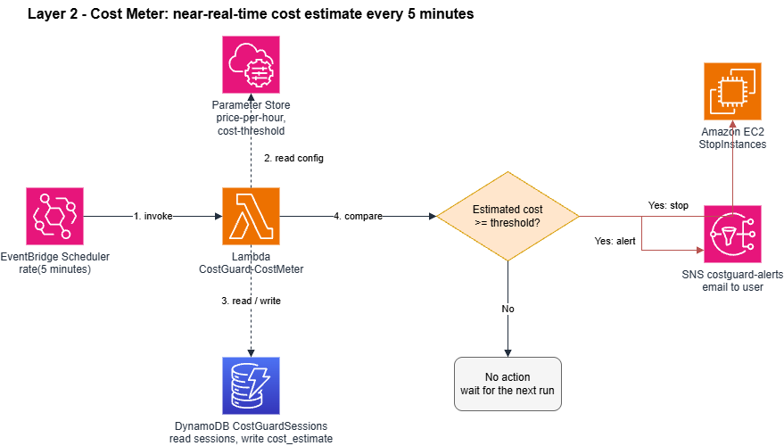
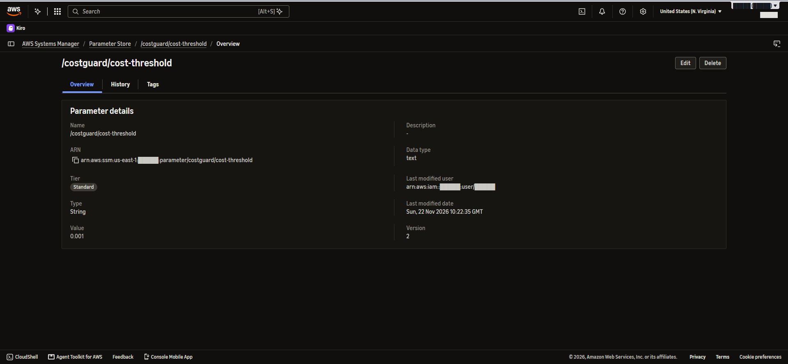
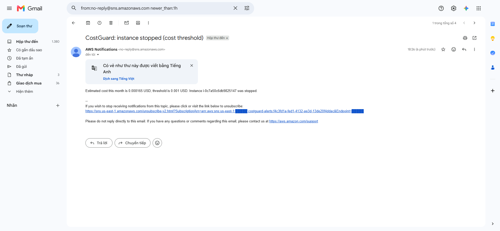
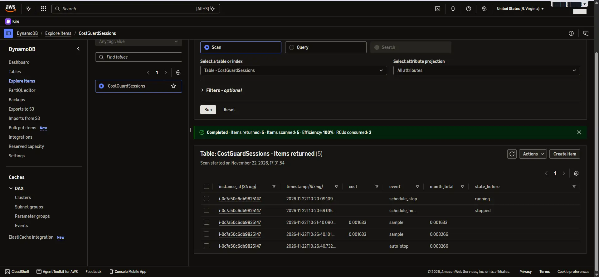
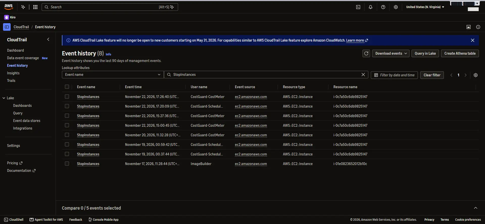

## Lớp 2 – Cost Meter

Lớp 2 ước tính máy lab đã tốn bao nhiêu tiền trong tháng và dừng máy khi ước tính chạm ngưỡng. Lớp này phản ứng trong vài phút, vì nó dùng thời gian chạy của instance và đơn giá theo giờ đã cấu hình, không dùng dữ liệu billing. Đây là đóng góp riêng của dự án.



### Cách hoạt động

1. **EventBridge Scheduler** gọi `CostGuard-CostMeter` mỗi 5 phút (`rate(5 minutes)`).
2. Hàm đọc instance ID, đơn giá theo giờ và ngưỡng từ Parameter Store.
3. Nếu instance **không chạy**, hàm dừng tại đây.
4. Nếu đang chạy, hàm tính chi phí của khoảng thời gian này:

   ```text
   chi phí mỗi lần = đơn giá theo giờ × 5 ÷ 60
   ```

   Với $0.0392 mỗi giờ, mỗi lần chạy cộng thêm khoảng $0.0033.
5. Hàm đọc mọi bản ghi `sample` của tháng dương lịch hiện tại (UTC) trong `CostGuardSessions` và cộng lại. Đây là tổng của tháng.
6. Hàm ghi một bản ghi `sample` mới với chi phí của lần này và tổng mới của tháng.
7. Nếu tổng đạt ngưỡng, hàm dừng instance, ghi bản ghi `auto_stop` và gửi cảnh báo tới `costguard-alerts`.

**Ngưỡng tính phần nào.** Ước tính chỉ tính chi phí chạy của EC2. Ổ EBS ($2.40 mỗi tháng) là chi phí cố định và được tính riêng trong ngân sách.

**Sau khi dừng tự động.** Tổng của tháng vẫn trên ngưỡng, nên nếu bạn bật lại máy, lần chạy kế tiếp (trong 5 phút) sẽ dừng máy lại. Máy bị khóa đến tháng dương lịch tiếp theo. Cách này giữ credit an toàn, và cái giá là không dùng được lab trong phần còn lại của tháng đó.

**Hạn chế đã biết.** Một phiên ngắn hơn một chu kỳ có thể không được tính, và tháng đổi vào nửa đêm UTC, tức 07:00 giờ Việt Nam.

### Bước 1 – Xem cấu hình

1. Mở **Systems Manager → Parameter Store** và đọc `/costguard/price-per-hour` (0.0392) và `/costguard/cost-threshold` (14).
2. Mở **EventBridge → Scheduler → Schedules** và kiểm tra `costguard-cost-meter` đang bật và dùng `rate(5 minutes)`.

### Bước 2 – Kiểm thử ngưỡng

Bạn không chờ đến ngưỡng thật $14. Bạn hạ ngưỡng xuống để lần chạy kế tiếp vượt qua nó.

1. Bật instance và chờ đến khi `running`.
2. Mở **Parameter Store → `/costguard/cost-threshold` → Edit** và đổi giá trị thành `0.001`. Ghi lại giờ trên đồng hồ khi bạn lưu.
3. Chờ lần chạy kế tiếp, tối đa 5 phút.
4. Kiểm tra console **EC2**, hộp thư và bảng DynamoDB.
5. **Đặt lại ngưỡng về `14`.** Đừng cập nhật CloudFormation stack trong lúc kiểm thử, vì như vậy giá trị cũng bị đặt lại.

**Kết quả trả về:** instance chuyển sang `stopping` rồi `stopped`. Bạn nhận email "CostGuard: instance stopped (cost threshold)". Bảng có một bản ghi `sample` và một bản ghi `auto_stop`.







### Bước 3 – Đo thời gian phản ứng

Mục tiêu của dự án là thời gian phản ứng dưới 5 phút, tức một chu kỳ của bộ đo.

1. Lấy giờ bạn lưu ngưỡng mới ở Bước 2.
2. Mở **CloudTrail → Event history**, lọc theo tên sự kiện `StopInstances` và đọc giờ của sự kiện.
3. Hiệu của hai mốc là thời gian phản ứng của lần kiểm thử này.

**Kết quả trả về:** hiệu số không lớn hơn chu kỳ của bộ đo. Hãy giữ số thật của lần chạy của bạn.

Ở lần chạy của nhóm, ngưỡng được lưu lúc 17:22:53 và CloudTrail ghi `StopInstances` bởi `CostGuard-CostMeter` lúc 17:26:40: thời gian phản ứng 3 phút 47 giây.



### Cần kiểm tra nếu gặp lỗi

- **Instance không dừng:** xem log group `/aws/lambda/CostGuard-CostMeter`. Hàm trả về `{"state": "stopped"}` ngay nếu thấy instance không chạy.
- **Không có bản ghi `sample`:** lịch `costguard-cost-meter` có thể đang tắt, hoặc instance không chạy lúc hàm chạy.
- **Không nhận được email:** kiểm tra đăng ký của `costguard-alerts` đã **Confirmed** chưa (xem 5.3).
- **Ngưỡng tự về 14 sau một lúc:** cập nhật stack sẽ đặt lại tham số về giá trị trong template. Hãy sửa tham số sau lần cập nhật cuối.
