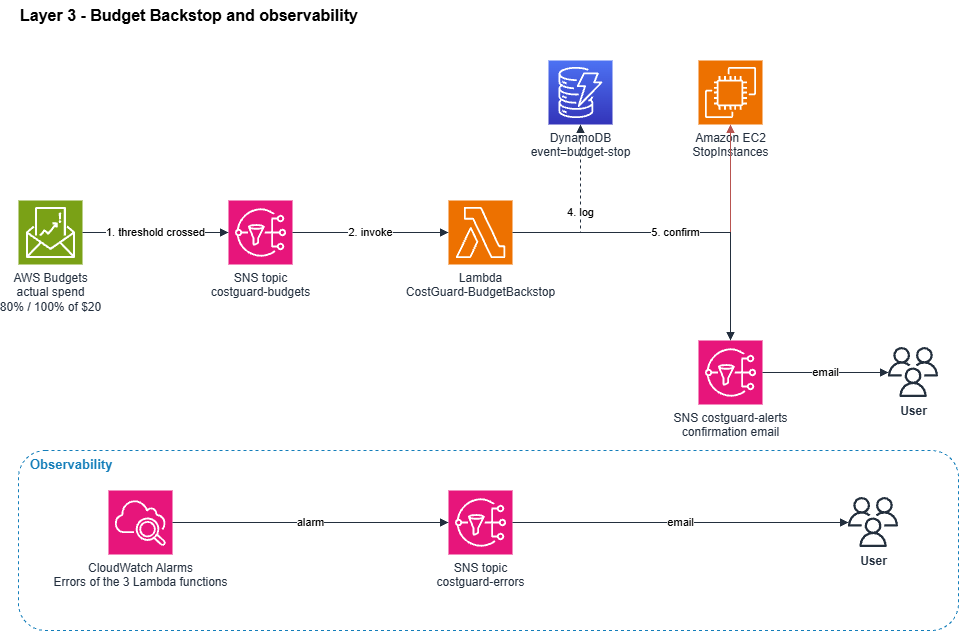
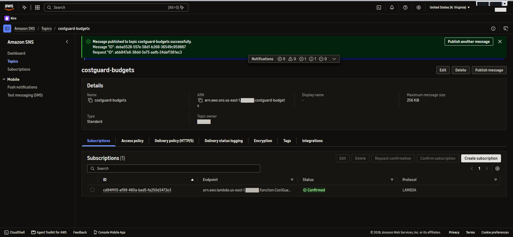
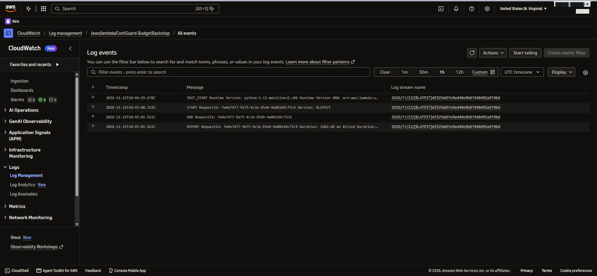
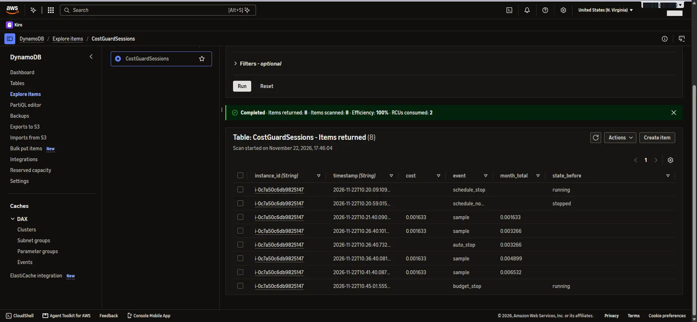
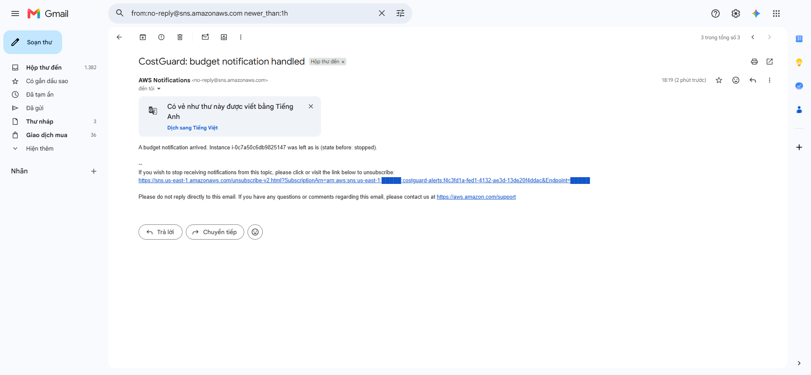
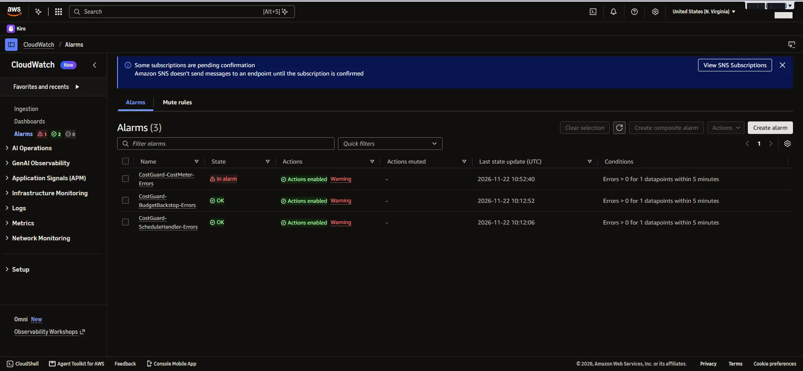
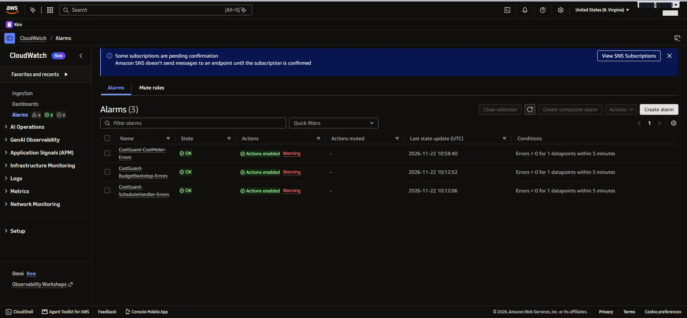
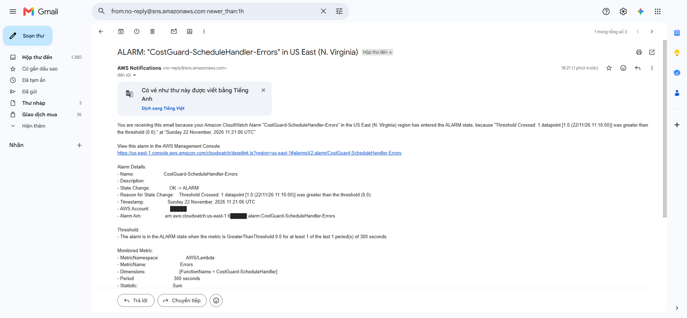

## Lớp 3 – Budget Backstop và giám sát

Lớp 3 là lưới an toàn cuối cùng. Lớp này theo dõi **chi tiêu thực** của tài khoản, nên chậm theo thiết kế: dữ liệu billing chỉ cập nhật vài lần mỗi ngày. Bước này cũng nói về các CloudWatch alarm báo cho bạn khi một trong ba hàm bị lỗi.

### Cách hoạt động

1. **AWS Budgets** theo dõi chi phí hằng tháng của tài khoản so với hạn mức $20 (`CostGuard-Budget`).
2. Khi chi phí thực vượt **80%** và vượt **100%** hạn mức, Budgets gửi thông báo tới SNS topic `costguard-budgets` và gửi email cho bạn.
3. Topic gọi hàm Lambda `CostGuard-BudgetBackstop`.
4. Hàm dừng instance nếu đang chạy, ghi `budget_stop` (hoặc `budget_noop`) vào `CostGuardSessions` và gửi xác nhận tới `costguard-alerts`.

### Ba lớp phối hợp thế nào

- Lớp 1 dừng máy vào giờ cố định.
- Lớp 2 dừng máy trong vài phút khi chi phí ước tính chạm ngưỡng.
- Lớp 3 dừng máy khi hóa đơn thật tiến gần hạn mức.

Lớp nào cũng dừng được máy, không lớp nào bật được máy, và dừng một máy đã dừng thì không có tác dụng. Vì vậy các lớp không xung đột, và một lớp lỗi không làm mất hai lớp còn lại.

### Bước 1 – Xem budget

1. Mở **Billing and Cost Management → Budgets** và chọn `CostGuard-Budget`.
2. Kiểm tra hạn mức hằng tháng và hai cảnh báo (80% và 100%, chi phí thực).

### Bước 2 – Kiểm thử Budget Backstop

Bạn không chờ hóa đơn thật tăng lên. Bạn tự gửi một tin nhắn tới topic.

1. Bật instance và chờ đến khi `running`.
2. Mở **SNS → Topics → `costguard-budgets` → Publish message**. Dùng tiêu đề và nội dung bất kỳ, rồi chọn **Publish message**.
3. Kiểm tra console **EC2**, hộp thư và bảng DynamoDB.

**Kết quả kỳ vọng:** instance chuyển sang `stopping` rồi `stopped`. Bạn nhận email "CostGuard: budget notification handled". Bảng có một bản ghi với `event = budget_stop`.

### Bước 3 – Xem các alarm

1. Mở **CloudWatch → Alarms**.
2. Bạn thấy ba alarm: `CostGuard-ScheduleHandler-Errors`, `CostGuard-CostMeter-Errors` và `CostGuard-BudgetBackstop-Errors`. Mỗi alarm theo dõi chỉ số `Errors` của hàm tương ứng và gửi tin tới `costguard-errors` khi chỉ số lớn hơn 0.
3. Mở **CloudWatch → Log groups**. Ba log group `/aws/lambda/CostGuard-*` giữ log trong 14 ngày.

### Bước 4 – Kiểm thử kịch bản lỗi

Bài kiểm thử này cố tình làm `CostGuard-CostMeter` lỗi để kiểm tra alarm và email hoạt động.

1. Mở **Parameter Store → `/costguard/instance-id` → Edit**. Ghi lại instance ID thật trước, rồi thay giá trị bằng `i-00000000000000000`.
2. Chờ tối đa 10 phút. Hàm chạy mỗi 5 phút và alarm dùng chu kỳ 5 phút.
3. Kiểm tra log của `CostGuard-CostMeter`, trạng thái alarm và hộp thư.
4. **Đặt lại instance ID thật.**

**Kết quả kỳ vọng:** hàm bị lỗi, bạn nhận email từ `costguard-errors`, và alarm `CostGuard-CostMeter-Errors` chuyển sang **In alarm**. Sau khi bạn khôi phục ID và lần chạy kế tiếp thành công, alarm trở về **OK**.

### Cần kiểm tra nếu gặp lỗi

- **Instance không dừng sau khi bạn gửi tin:** xem log group `/aws/lambda/CostGuard-BudgetBackstop`, và kiểm tra topic có đăng ký Lambda không.
- **Không có email từ `costguard-errors`:** đăng ký phải ở trạng thái **Confirmed**, và alarm cần trọn một chu kỳ để phản ứng.
- **Alarm vẫn ở OK:** mở biểu đồ metric của hàm và xem khoảng thời gian. Một lần chạy lỗi là một điểm dữ liệu 5 phút.
- **Budgets có vẻ không phản ứng với hóa đơn thật:** dữ liệu billing trễ hàng giờ, nên lớp này chỉ là lưới an toàn cuối.
